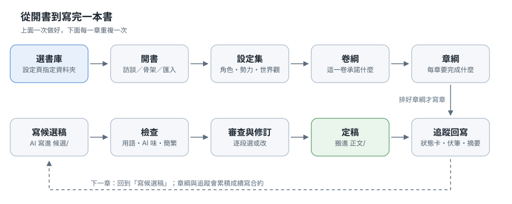
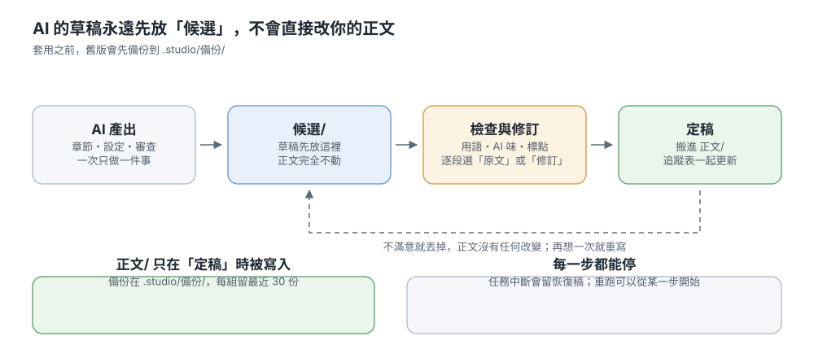

# Novel Studio

> Language: [繁體中文](README.md) · English · [日本語](README.ja.md)

A **local** workbench for writing long-form serial novels with AI. You decide where the story goes; the AI writes the words; the workbench keeps the files, the order of work and the memory of what happened earlier. Everything is plain text (Markdown plus a little YAML) in a folder you own, tied to no service.

This page goes from installation all the way to a finished book. To see the screens first, download the [tutorial slides](demo/小說工作台_新手教學.pptx) (Chinese only) or press "Add sample book" on the bookshelf.

## What this workbench does

It splits "write a book" into pieces you can do separately: settings, outlines, one chapter, checking, revision, final draft. Each piece can be re-run alone, so a step you do not like never forces you to redo everything.

### How the work is split

- **You** decide the story, read the drafts and choose which version stays. Every "should it?" stays with you.
- **The AI** does one thing at a time — write this chapter, review this chapter, turn these notes into a table. It reads the real files in your folder.
- **The workbench** keeps files and order. AI drafts always land in `候選/` (candidates) first; nothing enters your manuscript until you accept it, and everything is backed up before it is touched.

The AI can be swapped: Claude Code (your Claude subscription), or DeepSeek, llama.cpp or any OpenAI-compatible service. Switch runners and the same book still reads.

## Install

### Windows

1. Install [Python 3.9 or newer](https://www.python.org/downloads/) and tick "Add python.exe to PATH".
2. Download or `git clone` this project anywhere.
3. Double-click `start.bat`. The first run creates a virtual environment and installs the packages; it takes a few minutes.
4. Your browser opens http://127.0.0.1:8765 .

### macOS and Linux

Run `./start.sh` in a terminal. Everything else is the same.

### First start

The workbench runs only on your own machine (127.0.0.1) and is not exposed to the network. On first start the bookshelf asks you to pick a folder as the **library** — make a new folder such as `novels` inside your documents. It never reuses an existing folder on its own.

To look around first, press "Add sample book": it drops in a three-chapter sample you can change or delete freely. The Chinese sample is [《退婚之後》](demo/退婚之後/); the English one is [*The Lantern Road*](demo/en_TheLanternRoad/); the Japanese one is [《辺境の薬師と竜の約束》](demo/ja_辺境の薬師と竜の約束/).

For backend setup (DeepSeek keys, a llama.cpp endpoint), see **[Install and settings](docs/安裝與設定.md)**.

## Start a new book

1. **Create the book.** On the bookshelf press "New book". Three ways to start: an interview (the workbench asks a round of questions and produces the skeleton), a skeleton borrowed from a reference book, or importing an existing manuscript.
2. **Story bible.** Character cards, factions, world, story core. Write them by hand or let the AI draft and edit.
3. **Volume outline.** What this volume promises the reader, and which chapters it covers.
4. **Chapter cards.** One card per chapter saying what that chapter must achieve. "Plan the cards for this volume" does a whole volume at once.
5. **Write.** Write chapter one, or let Full-chapter automation run all the way to the final draft.

The setup interview also writes a `CLAUDE.md` — the book's writing charter, read by the AI on every task.

## Writing a chapter

### Candidate drafts: the AI's draft stays aside

Press "Write chapter". The draft lands in `候選/` (candidates); not a character of your manuscript changes. Send it back for a rewrite, or throw it away — your manuscript is untouched.

### Checks and revision

Several local checks sit next to the candidate: wording and typos, AI-sounding prose, simplified characters and punctuation. To change sentences, use "Review and revision": it lists the original and the proposal passage by passage, you pick one per passage, then apply.

Traditional Chinese books get one more layer: the model occasionally returns Simplified Chinese or mainland wording, and the workbench converts it to Traditional, swaps in Taiwan wording and full-width punctuation before writing, telling you what it changed. When a whole passage is simplified it does not silently convert — it asks you to re-run that step instead.

### Final draft: into the manuscript, tracking updated

"Accept" moves the candidate into `正文/` (the manuscript) and updates tracking (chapter summary, status card, threads, timeline, glossary) in the same move. Until then tracking does not change, so revising an old chapter never rewinds later records.

Every file is backed up to `.studio/備份/` before it is touched, keeping the newest 30 per group.

## Let it run on its own

Full-chapter automation chains the steps: plan the card → write the chapter → check against the card → de-AI polish → style check → review → auto-tick the notes → revise → apply → accept and write tracking back. If any step fails it stops there; fix it and continue from that step without redoing the earlier ones.

- **Autopilot.** Every K chapters it pauses to check the must-fix issues and style drift, and refuses to keep writing when they fail.
- **It will not wait forever.** A step that runs past 30 minutes, or produces no output for 10 minutes, is stopped and reported, so you can continue from that step.
- **Interruptions are recoverable.** When a task is cut off or you press stop, the text already written is saved as a recovery draft.

## What a book looks like on disk

A book is one folder with six subfolders: `設定/` (settings), `大綱/` (outlines), `正文/` (manuscript), `候選/` (candidates), `追蹤/` (tracking) and `.studio/`. Pure text throughout: open it, edit it directly, refresh the page (the workbench always reads the files). Folder and file names stay Chinese in every language — that is why the diagram labels are Chinese. The story text, summaries, chapter titles and the exported table of contents follow the book's language; the interface language is a separate setting (bottom right).

**`.studio/` is not a cache**: it holds backups, task records, indexes and reverse-engineering progress. To free space, delete only cache files, never the folder.

To move machines, copy the folder. To keep versions, use git or any sync tool.

## Other everyday features

- **Export.** EPUB 3 or plain text, optional chapter range, can include outlines, chapter cards, the story bible and tracking.
- **Illustrations.** Connect Stable Diffusion WebUI Forge Neo or ComfyUI for covers, chapter and setting images, with style presets and prompt management.
- **Import a manuscript.** TXT, Markdown or Word; encoding is detected and chapters are split, with optional Simplified-to-Traditional conversion.
- **Build settings from the text.** For a finished book, the AI works backwards to characters, factions, world, outlines and tracking. Drafts wait for review: reverse-engineered chapter cards go to `大綱/章綱/反推/` and never touch the real ones, every other file is kept, replaced or merged per file, and anything overwritten is backed up first. Adopted cards can be reviewed read-only from the “Reverse chapter cards” card on the Outline page.
- **Shared library.** Build a style or a chapter structure once and apply it to every book.
- **Reader knowledge ledger and relationship table.** What the reader knows so far and who relates to whom, fed into context when continuing.
- **Drift check.** At the end of a volume, compare what the outline promised with what was written, and draft an outline update.
- **Continuation contract.** Fixes the immutable facts, the voice and the open promises, and is honoured first when continuing.

## Troubleshooting

A button that does nothing, or "claude command not found": set the Claude Code path on the Settings page (`where claude` on Windows, `which claude` elsewhere).

"No permission to write this file" usually comes from how the app was started: launch it from a virtual environment outside the project (set `NS_VENV`, then run `start.bat`), and make sure the library is not a folder OneDrive or an anti-virus is holding.

Other common cases: truncated output (raise "max output"; the cut text is saved as a recovery draft), "context over the limit, skipping: writing craft" (not an error, only the least important reference is dropped), a task that seems idle (it stops after 10 minutes without output, then continue from that step).

"Report a problem" at the bottom of the left sidebar opens an issue.

## Learn more

### Developers and contributors

Installation details are in **[Install and settings](docs/安裝與設定.md)**; feature details, the differences between runners, how it works, the project layout and contributor tools moved to **[Developers and feature details](docs/開發者.md)**. Design notes live in `docs/`: [continuation contract](docs/續寫合約.md), [drift detection](docs/漂移偵測.md), [style loop](docs/文風閉環.md), [retrieval memory](docs/檢索式記憶.md), [autopilot](docs/自動駕駛.md), [regression tests](docs/回歸測試.md), [multilingual workflow](docs/i18n-workflow.md). Changes are listed in the [CHANGELOG](CHANGELOG.md).

Released under the [MIT licence](LICENSE). Third-party packages and design references are listed in [THIRD_PARTY_NOTICES](THIRD_PARTY_NOTICES.md) and on the "About" page.
