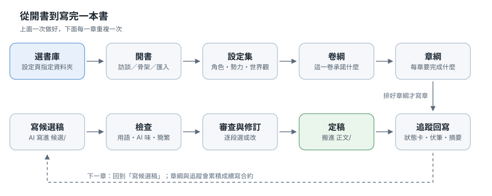
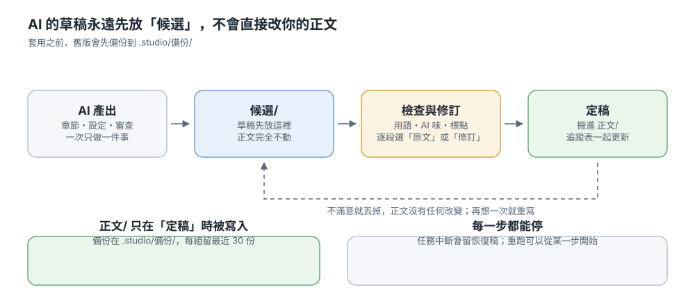

# 小説ワークベンチ Novel Studio

> 言語：[繁體中文](README.md) · [English](README.en.md) · 日本語

AI と一緒に長編の連載小説を書くための**ローカル**なワークベンチです。物語の行き先を決めるのはあなた、文章を書くのは AI、ファイルと段取りと前後の記憶を預かるのがワークベンチです。原稿はすべてプレーンテキスト（Markdown と少しの YAML）で、自分のフォルダに入ります。特定のサービスには縛られません。

このページは、インストールから一冊を書き上げるまでを通しで説明します。先に画面を見たいときは[チュートリアルのスライド](demo/小說工作台_新手教學.pptx)（繁体字中国語のみ）を開くか、本棚の「サンプルブックを追加」を押してください。

## このワークベンチができること

「一冊書く」を、別々に進められる作業に分けます：設定、あらすじ、一章を書く、チェック、修正、確定。どの作業も単独でやり直せるので、気に入らない一手順のせいで全部をやり直すことはありません。

### 役割の分け方

- **あなた**：物語を決め、下書きを読み、どの版を残すかを決めます。「どうするか」の判断はすべてあなたの側にあります。
- **AI**：一度に一つだけ——この章を書く、この章をレビューする、このメモを表にする。読むのはフォルダに入っている本物のファイルです。
- **ワークベンチ**：ファイルと段取りを管理します。AI の原稿はまず `候選/`（候補稿）に入り、あなたが確定するまで本文には入りません。書き換える前には必ずバックアップします。

AI は入れ替えられます：Claude Code（お手持ちの Claude サブスクリプション）、DeepSeek、llama.cpp、そのほか OpenAI 互換のサービス。どれに替えても、同じ本のデータをそのまま読めます。

## インストール

### Windows

1. [Python 3.9 以上](https://www.python.org/downloads/)をインストールします（「Add python.exe to PATH」にチェック）。
2. このプロジェクトをダウンロードするか `git clone` して、好きな場所に置きます。
3. `start.bat` をダブルクリックします。初回は仮想環境の作成とパッケージのインストールが走り、数分かかります。
4. ブラウザが自動で開きます：http://127.0.0.1:8765 。

### macOS / Linux

ターミナルで `./start.sh` を実行します。あとは同じです。

### はじめての起動

ワークベンチは自分のパソコンの中だけで動きます（127.0.0.1）。外には公開されません。初回は本棚のページで、**書庫**にするフォルダを一つ選びます。「書類」の下に `小説` のような新しいフォルダを作るのがおすすめです。すでにあるフォルダを勝手に使うことはありません。

先に画面を見たいときは「サンプルブックを追加」を押してください。三章分のサンプルが入り、自由に書き換えても消してもかまいません。中国語は[『退婚之後』](demo/退婚之後/)、英語は[*The Lantern Road*](demo/en_TheLanternRoad/)、日本語は[『辺境の薬師と竜の約束』](demo/ja_辺境の薬師と竜の約束/)です。

実行環境（DeepSeek の API キー、llama.cpp の URL）の設定は **[インストールと設定](docs/安裝與設定.md)** を見てください。

## 新しい本を始める

1. **本を作る。** 本棚の「新しい本」を押します。始め方は三つ：作成インタビュー（いくつかの質問に答えると骨格ができます）、参考書の骨格を使う、既存の原稿を取り込む。
2. **設定集。** 人物カード、勢力、世界観、物語の核。手で書いても、AI に草稿を作らせて直してもかまいません。
3. **巻のあらすじ。** この巻が読者に約束すること、どの章からどの章までを扱うか。
4. **章カード。** 一章に一枚、その章で何を達成するかを書きます。「この巻の章カードを並べる」で一巻分をまとめて作れます。
5. **書き始める。** 第一章をそのまま書くか、章の自動作成フローで確定まで一気に走らせます。

作成インタビューは `CLAUDE.md` も書き出します。これはこの本の執筆憲章で、AI が毎回読みます。

## 章を書くときの流れ

### 候補稿：AI の原稿はまず別に置く

「この章を書く」を押すと、原稿は `候選/`（候補稿）に入ります。本文は一文字も変わりません。気に入らなければ差し戻して書き直すか、そのまま捨ててください。本文はそのままです。

### チェックと修正

候補稿の横で、いくつかのチェックを押せます：用語と誤字、AI っぽさ、簡体字と句読点。文を変えたいときは「レビューと修正」を使います。「元の文」と「提案」が段落ごとに並ぶので、段落ごとにどちらかを選んで適用します。

繁体字中国語の本にはもう一层の保護があります：モデルがときどき簡体字や中国大陸の言い回しを返すため、ワークベンチは書き込む前に繁体字へ直し、台湾の言い回しと全角の句読点にそろえ、どこを直したかを結果に書きます。段落まるごとが簡体字のときは無理に直さず、その手順をやり直すよう促します。

### 採用：本文へ移し、追跡も更新

「採用」を押すと候補稿が `正文/`（本文）に移り、同じ操作で追跡資料（章の要約、状態カード、伏線、年表、用語集）も更新されます。採用するまで追跡は変わらないので、古い章を直しても後ろの記録が巻き戻ることはありません。

ファイルを書き換える前には必ず `.studio/備份/` にバックアップを取り、同じ組ごとに最新 30 份まで残します。

## 自動で走らせる

章の自動作成フローは手順をつなぎます：章カードを並べる → 章を書く → 章カードと照合 → AI っぽさの除去 → 文体チェック → レビュー → 意見の自動選択 → 修正 → 適用 → 採用して追跡へ書き戻し。途中で失敗したらその手順で止まり、直してからその手順だけ続けられます。前の手順をやり直す必要はありません。

- **自動運転。** K 章ごとに一度止まって、必須修正と文体のずれを点検します。不合格なら書き進めません。
- **いつまでも待ちません。** 一手順が 30 分を超えたとき、または 10 分間まったく出力がないときは、そのタスクを止めて知らせます。そのあと手順から続けられます。
- **中断しても救えます。** タスクが切れたり停止したとき、それまでに書けた文章は復旧稿として保存されます。

## 本はディスク上でどんな形か

本は一つのフォルダで、中に六つのサブフォルダがあります：`設定/`（設定）、`大綱/`（あらすじ）、`正文/`（本文）、`候選/`（候補稿）、`追蹤/`（追跡）、`.studio/`。すべてプレーンテキストなので、開いてそのまま直せます（ワークベンチは毎回ファイルを直接読みます。更新すればすぐ反映されます）。フォルダ名とファイル名はどの言語でも中国語のままです。図のラベルが中国語なのはそのためです。本文・要約・章名、そして書き出したときの目次は本の言語に従います。画面の言語は右下の別設定です。

**`.studio/` は一時ファイル置き場ではありません**：バックアップ、タスク記録、索引、逆分解の進捗が入っています。容量を空けたいときはキャッシュのファイルだけを消し、フォルダごと消さないでください。

引っ越しはフォルダをコピーするだけ。版を残したいときは git か好きな同期ツールを使ってください。

## そのほかのよく使う機能

- **書き出し。** EPUB 3 またはプレーンテキスト。章の範囲を選べ、あらすじ、章カード、設定集、追跡資料も一緒に出せます。
- **挿絵。** Stable Diffusion WebUI Forge Neo か ComfyUI をつなぎ、表紙・章・設定の挿絵を、画風とプロンプトの管理つきで作れます。
- **原稿の取り込み。** TXT、Markdown、Word。文字コードを判定して章に分け、簡体字から繁体字への変換もできます。
- **本文から設定を作成。** 書き終わった本から、人物、勢力、世界観、あらすじ、追跡資料を AI が逆算して作ります。草稿はまず確認用に置かれ、章カードは `大綱/章綱/反推/` へ別名保存して本物の章カードには触れません。それ以外はファイルごとに「現状維持／逆算版で置き換え／足りない段落だけ統合」を選び、上書き前には必ずバックアップします。採用した章カードは「あらすじ」ページの「反推章綱」カードから読み取り専用で確認できます。
- **共有ライブラリ。** 文体や章の構成を一度作れば、どの本にも当てられます。
- **読者の認知台帳とキャラ関係。** 「読者が今どこまで知っているか」と人物どうしの関係を記録し、続きを書くときに文脈へ入れます。
- **ドリフト点検。** 巻の終わりに「あらすじにあったのに書いていない」「書いたのにあらすじにない」を比べ、あらすじ更新の草稿を作れます。
- **続き書きの契約。** 変えてはいけない事実、声、未回収の約束を固定し、続きを書くときに最優先で守ります。

## 困ったとき

ボタンが反応しない、「claude コマンドが見つからない」と出る：設定ページで Claude Code のパスを入れてください（Windows は `where claude`、それ以外は `which claude`）。

「このファイルに書き込む権限がありません」は起動方法が原因のことが多いです：プロジェクトの外の仮想環境から起動し（`NS_VENV` を設定して `start.bat`）、書庫が OneDrive やウイルス対策ソフトに掴まれていないか確認してください。

そのほかよくあるのは：出力が途中で切れる（「最大出力」を上げる。切れた分は復旧稿として残ります）、「文脈が上限を超えたため省略：執筆の技法」（エラーではなく、重要度の低い参考だけを省いています）、タスクが動いていないように見える（10 分間出力がないと自動で止まります。そのあと手順から続けてください）。

左メニューの一番下の「問題を報告」から issue を立てられます。

## もっと詳しく

### 開発者とコントリビューター

インストールの詳細は **[インストールと設定](docs/安裝與設定.md)**、機能の詳細・実行環境ごとの違い・動作の仕組み・ファイル構成・コントリビューター向けツールは **[開発者と機能の詳細](docs/開發者.md)** に移しました。設計と検証の記録は `docs/` にあります：[続き書きの契約](docs/續寫合約.md)、[ドリフト検出](docs/漂移偵測.md)、[文体ループ](docs/文風閉環.md)、[検索型の記憶](docs/檢索式記憶.md)、[自動運転](docs/自動駕駛.md)、[回帰テスト](docs/回歸測試.md)、[多言語の流れ](docs/i18n-workflow.md)。変更履歴は [CHANGELOG](CHANGELOG.md)。

このプロジェクトは [MIT ライセンス](LICENSE) で公開しています。利用している第三者パッケージと設計の参考は [THIRD_PARTY_NOTICES](THIRD_PARTY_NOTICES.md) と、左下の「このアプリについて」にまとめています。
