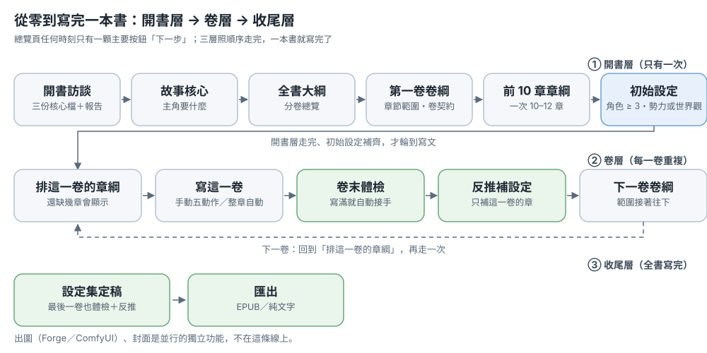
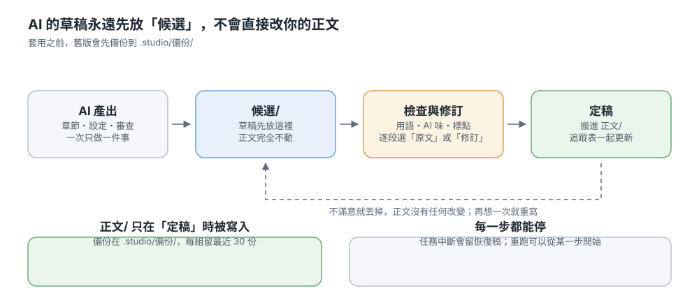

# 小說工作台 Novel Studio

> 語言：繁體中文 · [English](README.en.md) · [日本語](README.ja.md)

用 AI 寫長篇連載小說的**本機**工作台。你決定故事要怎麼走，AI 負責把字寫出來，工作台負責管檔案、排流程、記住前後文。所有稿件都是純文字（Markdown 加一點 YAML），放在你自己的資料夾裡，不綁任何服務。

這份說明從安裝一路講到把一本書寫完。想先看畫面，可以下載[新手教學簡報](demo/小說工作台_新手教學.pptx)，或按書架上的「加入示範書」實際玩一遍。

## 這個工作台能幫你做什麼

它把「寫一本書」拆成幾件可以分開做的事：想設定、排大綱、寫一章、檢查、修、定稿。每一件都能單獨重跑，不會因為某一步不滿意就得全部重來。

### 它怎麼跟你分工

- **你**：決定故事、看草稿、決定哪一版留下。所有「要不要」的決定都在你手上。
- **AI**：一次只做一件事——這次寫這章、這次審這章、這次把設定整理成表格。它讀的是你資料夾裡的真實檔案。
- **工作台**：管檔案與流程。AI 的草稿永遠先放「候選」，你按下定稿才會進正文；動任何檔案之前會先備份。

AI 可以換：用 Claude Code（用你的 Claude 訂閱），或 DeepSeek、llama.cpp、任何 OpenAI 相容的服務。換哪一家，同一本書的資料都讀得懂。

## 安裝

### Windows

1. 安裝 [Python 3.9 以上](https://www.python.org/downloads/)（安裝時勾「Add python.exe to PATH」）。
2. 下載或 `git clone` 這個專案，放在任何地方。
3. 雙擊 `start.bat`。第一次會自動建立虛擬環境並安裝套件，需要幾分鐘。
4. 瀏覽器會自己開啟 http://127.0.0.1:8765 。

### macOS / Linux

在終端機執行 `./start.sh`，其餘同上。

### 第一次啟動

工作台只在自己的電腦上執行（127.0.0.1），不會對外開放。第一次打開時，書架頁會請你選一個資料夾當**書庫**——建議在「文件」底下開一個新的 `小說` 資料夾。工作台不會自己去用你既有的資料夾。

想先熟悉介面，按「加入示範書」，它會放一本三章份量的示範作品進去，可以隨便改、隨便刪。

需要設定後端（DeepSeek 金鑰、llama.cpp 網址）時看 **[安裝與設定](docs/安裝與設定.md)**。

## 開一本新書

一本書的流程分三層：**開書層**（只有一次）→ **卷層**（每一卷重複一次）→ **收尾層**（全書寫完）。
任何時刻總覽頁只有一顆主要按鈕，就是「下一步」；其他動作都是次要，不用自己找路。

### ① 開書層（只有一次）

1. **開書**：書架按「開新書」。三種起步方式——直接訪談（工作台問你一輪問題就生出骨架）、用一本參考書的骨架開新書、或匯入既有的舊稿。
2. **四步把骨架定下來**：故事核心 → 全書大綱 → 第一卷卷綱 → 前 10 章章綱。總覽頁的步驟條會說你卡在第幾步，按「下一步」就是按下一步該做的事。
3. **初始設定**：輪到寫之前，先讓角色、勢力、世界觀有內容（角色至少 3 個正式檔，勢力或世界觀至少一個）。按「從大綱長設定」生草稿，再按「草稿轉正式」定案；只停在草稿不算完成。

開書訪談會寫出一份 `CLAUDE.md` 給 AI 讀，等於這本書的寫作公約。

### ② 卷層（每一卷重複）

1. **排這一卷的章綱**：一次 10–12 章。總覽會說「這一卷排到第幾章、還缺幾章」。
2. **寫這一卷**：手動是一章五個動作（寫 → 去 AI 味 → 審查 → 修訂 → 採用），逐段可以停；卷層卡上有「這一卷剩下的用自動跑」，交給整章自動流程。
3. **卷末體檢**：這一卷寫滿時，「下一步」自動變成「卷末體檢」——比對卷綱與正文的落差、伏筆欠帳與文風偏離，需要時產生卷綱更新草稿。
4. **補這一卷的設定**：同一張卡有「從正文反推設定（補這一卷）」，把這一卷的角色狀態、新名詞、追蹤資料補回來，下一卷才不會拿舊資料寫。
5. **開下一卷**：體檢做完，「下一步」變成「第二卷卷綱」，接著又回到排章綱 → 寫文，一直重複到全書寫完。

### ③ 收尾層

全書寫完之後，最後一卷照樣做卷末體檢與反推補設定，設定集就是定稿狀態。出圖、EPUB 與封面是並行的獨立功能，不在這條流程上。

## 平常怎麼寫一章

### 候選稿：AI 的草稿先放旁邊

按「寫這一章」，AI 寫完的稿子會進 `候選/`，正文一個字都不會動。不滿意就退回重寫，或直接丟掉，你的正文完全沒有改變。

### 檢查與修訂

候選稿旁邊有幾種檢查可以按：用語與錯字、AI 味、簡繁與標點。要動句子時用「審查與修訂」——它逐段列出「原文」和「建議」，你一段一段選要哪一個，再按套用。

繁體中文的書還有一層保護：模型偶爾會用簡體或大陸用語，工作台在寫入檔案前會自動轉成繁體、換成台灣用語與全形標點，並在結果裡告訴你改了哪些。「整段都是簡體」時它不會硬轉，而是提示你重跑那一步。

### 定稿：搬進正文、追蹤一起更新

按「定稿」把候選稿搬進 `正文/`，同時更新追蹤資料（章節摘要、狀態卡、伏筆、時間線、名詞表）。在那之前追蹤完全不會變，所以修舊章不會把後面的紀錄弄亂。

動檔之前一律先備份到 `.studio/備份/`，每一組檔案留最近 30 份。

## 交給它自動跑

「整章自動流程」把上面那些步驟串起來：排章綱 → 寫章節 → 核對章綱 → 去 AI 味 → 文風檢查 → 審查 → 自動勾選 → 修訂 → 套用 → 定稿回寫。中間任何一步失敗就停在那一步，修好之後可以從那一步繼續，不用重跑前面。

- **自動駕駛**：每寫 K 章自動停下來體檢一次（必須修的問題、文風偏離），不及格就不往下寫。
- **卡住不會永遠等**：一步超過 30 分鐘、或 10 分鐘完全沒有輸出，工作台會把那個任務停掉並告訴你哪一步失敗，可以從那裡繼續。
- **中斷有救**：任務被截斷或你按停止，已經寫出來的部分會存成恢復稿。

## 一本書在硬碟上長什麼樣

一本書就是一個資料夾，裡面六個子資料夾：`設定/`、`大綱/`、`正文/`、`候選/`、`追蹤/`、`.studio/`。全部是純文字，可以直接開來看、直接改（工作台每次都直接讀檔，改完重新整理就看到）。

資料夾名、檔名與欄位名一律是**中文固定詞**，不管這本書用哪種語言寫；書的內容（正文、摘要、章名）與匯出後的目錄才跟著書的語言。介面語言是右下角的另一個設定。

**`.studio/` 不是暫存**：裡面是備份、任務紀錄、索引與反推進度。要清空間請只刪快取檔，不要整個資料夾刪掉。

換電腦就是複製這個資料夾；想留版本就用 git 或任何同步工具。

## 其他常用功能

- **匯出**：EPUB 3 或純文字，可選章節範圍，可帶大綱、章綱、設定集、追蹤資料。
- **插圖**：接 Stable Diffusion WebUI Forge Neo 或 ComfyUI，封面／章節圖／設定圖，含畫風與提示詞管理。
- **匯入舊稿**：TXT、Markdown、Word 自動判斷編碼並拆章，可順便簡轉繁。
- **從正文建立設定**：已經寫完的書，讓 AI 反推角色、勢力、世界觀、大綱與追蹤資料。草稿先落地、分組核對再採用；章綱一律另存 `大綱/章綱/反推/`，其他組逐檔選「保留現有／用反推版／併入缺的段落」，覆蓋前先備份；採用後的章綱可在「大綱」頁的「反推章綱」卡唯讀對照。
- **共用庫**：文風與章節結構做好一次，所有書都能套用。
- **讀者認知帳本、角色關係表**：記「讀者現在知道什麼」與角色之間的關係，續寫時自動帶進上下文。
- **漂移體檢**：卷末檢查「卷綱有、實際沒寫到」與「實際有、卷綱沒安排」的落差，可產生卷綱更新草稿。
- **續寫合約**：把不可變的事實、聲線與待收懸念固定下來，續寫時優先遵守。

## 遇到問題

按鈕沒反應、或出現「找不到 claude 指令」時，在工作台的「設定」頁填好 Claude Code 的路徑（命令提示字元打 `where claude` 可以查）。

出現「沒有權限寫入這個檔案」通常是啟動方式造成的：請用專案外的虛擬環境啟動（設定 `NS_VENV` 後再跑 `start.bat`），或確認書庫不在被 OneDrive／防毒鎖住的資料夾。

其他常見狀況：輸出被截斷（提高「最大輸出」，截斷的部分會留成恢復稿）、「上下文超出長度，略過：寫作技法」（不是錯誤，只是少帶最不重要的參考）、任務似乎沒動（等 10 分鐘沒有輸出會自動停，之後從那一步繼續）。

左側欄最底下有「回報問題」，可以直接開 issue。

## 想更了解

### 開發者與貢獻者

安裝細節在 **[安裝與設定](docs/安裝與設定.md)**；功能細節、各執行者的差異、運作方式、檔案結構與貢獻者工具搬到 **[開發者與功能細節](docs/開發者.md)**。各功能的設計與驗證另外放在 `docs/`：[續寫合約](docs/續寫合約.md)、[漂移偵測](docs/漂移偵測.md)、[文風閉環](docs/文風閉環.md)、[檢索式記憶](docs/檢索式記憶.md)、[自動駕駛](docs/自動駕駛.md)、[回歸測試](docs/回歸測試.md)、[多語系流程](docs/i18n-workflow.md)。改動紀錄看 [CHANGELOG](CHANGELOG.md)。

專案以 [MIT 授權](LICENSE) 發布。使用到的第三方套件與設計參考列在 [THIRD_PARTY_NOTICES](THIRD_PARTY_NOTICES.md) 與工作台左下角的「關於」頁。
