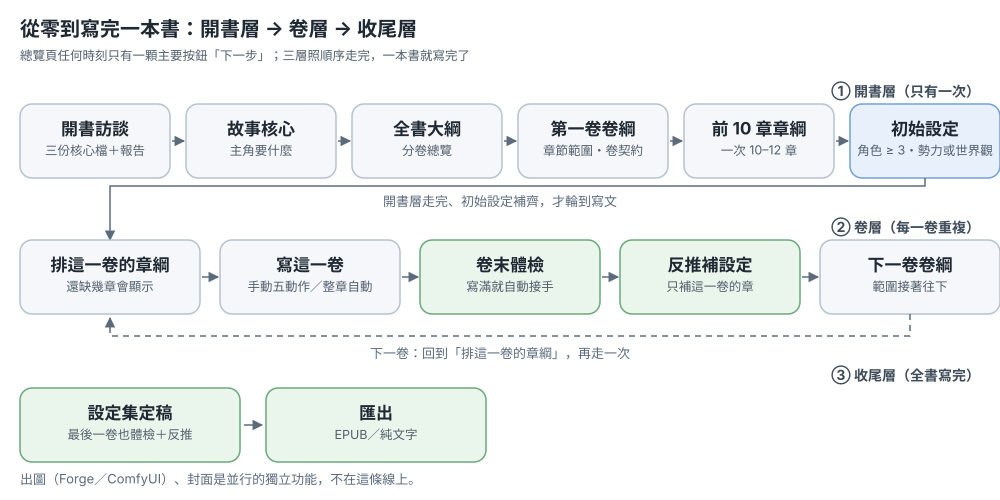
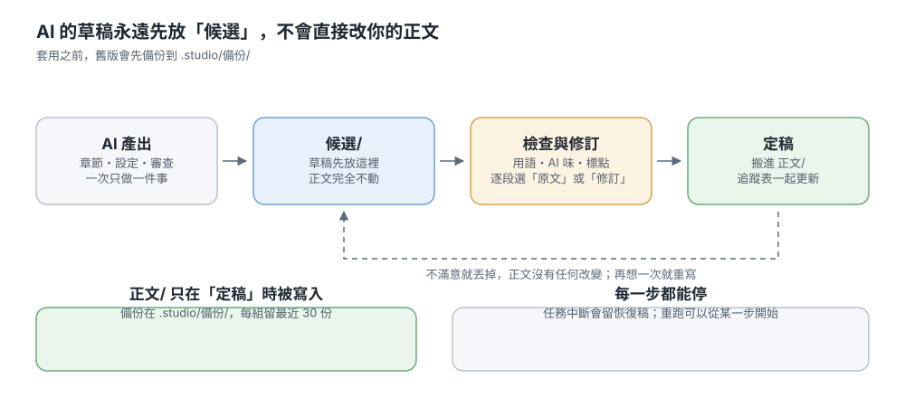
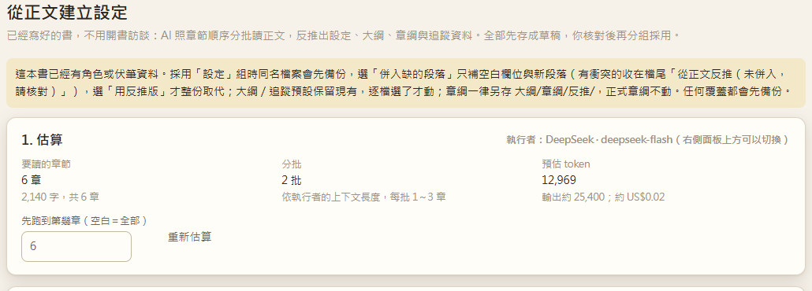

# User guide

> Novel Studio is a local writing workbench: a book is a folder, the manuscript is Markdown, and the AI only runs the pipelines for you.
> This is a static guide. Read the two workflows first, and check the glossary at the end when a term is unclear.

## What do you want to do?

| I want to… | Go to |
|---|---|
| Write a whole book from scratch | Workflow 1: writing a whole book from scratch |
| Turn an existing manuscript into a project | Workflow 2 A: import an old manuscript |
| Start a new book from an old book's skeleton | Workflow 2 B: spin off a new book |
| Generate characters, factions, worldview | How the settings bible grows |
| Look up a term | Glossary |
| Know which button is the right one | Duplicate entry points (some actions currently have several entrances) |

## Interface map

- **Shelf** (top of the left rail, or `#/`): all books, new book, import old manuscript
- **Inside a book, left rail**: Overview, Chapters, Outline, Settings, Foreshadowing & timeline, Jobs, Illustrations, Export
- **Right panel**: AI runner, action forms, job stream, reply box
- **Bottom right**: interface language; the actual model and library location live in Settings

---

## Workflow 1: writing a whole book from scratch

> One line in three layers: the **setup layer** (once) → the **volume layer** (once per volume) → the **wrap-up layer** (after the last chapter).
> At any moment the overview page has exactly one primary button, "**next step**". Press it. Everything else is secondary.

*Above: a book in three layers — setup once, the volume layer per volume, the wrap-up layer after the last chapter. Diagrams and screenshots show the Traditional Chinese interface; the text gives the labels.*

### Setup layer (once)

#### Step 0: create a new book

Bookshelf → "New book":

| Field | Advice |
|---|---|
| Title | Also the folder name; renaming later means renaming the folder yourself |
| One-line premise | One line is enough — the interview asks the rest |
| Writing language | Sets the language of prompts and model output; unrelated to the interface language |
| Advanced: reference book (optional) | Only its **style metrics and chapter structure** (numbers) are borrowed — no names, no plot |
| Advanced: also generate a story skeleton | Costs about 1–2 minutes and a few model calls; drafts land in `候選/新書草稿/` |

Pressing "Start setup" opens the **setup interview**: questions appear in the right-hand panel, one button per question. You can also type freely, or press "Skip, you decide" to let the model use a default (the report marks it "(default)"). After three rounds it writes, in one pass:

- `CLAUDE.md` — the book's writing charter, read by the AI on every task
- `設定/故事核心.md` and `設定/文風.md`
- a **setup report** in the panel: which files actually exist, what is still empty, and which step comes next

**If it gets stuck:** an interrupted interview (no `CLAUDE.md`) shows "setup interview unfinished" on the overview — press "Continue setup interview". With the Claude Code executor there are no option buttons; the panel tells you to switch to an API executor.

#### Step 1: story core

Overview → "Next step: story core" → "Start story-core diagnosis". About a minute: what the protagonist wants, what blocks it.

Output: `設定/故事核心.md` (≥ 120 characters, and the `<!--` template comment must be filled in).

#### Step 2: whole-book outline

"Next step: whole-book outline" → it first gives a **per-volume overview** (theme, chapter count, end-of-volume state). Reply with changes until you like it; files are written only after you confirm.

Output: `大綱/全書大綱.md` (≥ 500 characters).

#### Step 3: first volume outline

The **volume card** at the top of the Outline page → "New volume" → fill the volume number and its **chapter range** (this range is what decides "which chapters belong to this volume"; 20 chapters is fine to start, it can change later).

1. What you get is a **draft**: `大綱/草稿/卷綱_第1卷.md`, editable by hand
2. Happy with it, press "**Adopt**": it becomes the real outline `大綱/卷綱_第1卷.md`, status "confirmed", and is appended to `大綱/全書大綱.md`
3. The "volume contract" inside is this volume's promise to the reader and is injected first when writing

**If it gets stuck:** the real outline is only written by "Adopt" or "Apply revision". If the volume card is missing, the book usually has no `大綱/全書大綱.md` yet.

#### Step 4: chapter cards for the first 10 chapters (+ card health check)

1. Volume card → "Plan this volume's chapter cards": it first gives a **one-line-per-chapter overview**
2. Reply "confirm" and only then are the card files written: `大綱/章綱/第NNN章_*.md`
3. Volume card → "Card check": catches **early appearance / spoilers** and **characters missing for too long**. Fix the cards before writing.

10–12 chapters at a time is enough; you do not have to plan the whole volume before writing.

#### Step 5: initial settings (before writing)

Characters, factions and the world need substance, or the whole volume gets written against an empty bible. **Passing test:** at least 3 real files in `設定/角色/` plus at least one in `設定/勢力/` or `設定/世界觀/` — **drafts do not count**.

1. Overview → "Next step: initial settings" → "Start initial settings" (this is the bible page's "Grow settings from the outline")
2. Tick characters / factions / world; optionally add a reference direction and URLs. It reads the whole-book outline, volume outlines and the card list
3. Everything lands in `設定/草稿/`
4. Once you have read them, press "**Promote drafts**" (the secondary button on the next-step card) to move them into `設定/角色/`, `設定/勢力/`, `設定/世界觀/`

**If it gets stuck:** with fewer than 3 characters, run "Grow settings from the outline" again or add them by hand on the bible page. Left as drafts, the next step never becomes writing.

### Volume layer (repeat per volume)

#### Step 6: write the volume

- **Manual** (watch every paragraph): chapter page "Write this chapter" → candidate draft → "De-AI" → "Review" → "Revise per ticked notes" → "Accept"
- **Automatic** (run it through in one go): "⚡ Full chapter" in the page header, or the volume card's "**Run the rest of this volume automatically**" (range pre-filled to the rest of this volume)

*Above: the five manual actions. The candidate draft always stays aside; only "Accept" moves it into the manuscript.*

The full-chapter pipeline: chapter card → write → card check → de-AI → style → review → tick issues → revise → apply → accept and write back tracking. These cases are stopped by **gates** (not a bug — go fix the data first):

- the chapter number is outside every "confirmed" volume outline range
- the chapter has no card yet
- the card has an early-appearance spoiler

Output: the draft sits in `候選/`; only "Accept" moves it into `正文/` and writes back tracking (summary, foreshadowing, timeline, character state, glossary).

**If it gets stuck:** a failing step stops right there and can be continued from that step; a step over 30 minutes, or 10 minutes without output, is stopped automatically and the partial text is kept as a **recovery draft**; every write is backed up under `.studio/備份/`.

#### Step 7: after each chapter

- **Candidate draft**: review it on the chapter page or single-chapter page, accept only when happy
- **Review / revision**: compare "original" and "suggestion" paragraph by paragraph; paragraphs you keep stay untouched
- **Tracking**: written back to the Foreshadowing & Timeline page on accept
- **Job log**: what ran, how many tokens, how much it cost

#### Step 8: end-of-volume check

Once the volume is full (every chapter in the range has text), the overview's next step becomes "**End-of-volume check**", and the check page already has this volume's range filled in.

*Above: when the volume is full the next step becomes the end-of-volume check; below it sits this volume's card.*

*Above: the check page already has this volume's range filled in.*

1. Press "Start check": it compares the bible against the manuscript and lists chapters that missed their card, characters absent too long, unpaid foreshadowing and style drift — computed locally, free
2. To change the outline, press "Produce volume-outline update draft", read it, then "Append to volume outline" (appended at the end of the file; the original text is untouched)

**If it gets stuck:** the next step staying on the check usually means the check has not run or no draft was written yet. This step deliberately has no "skip".

#### Step 9: backfill this volume's settings

Volume card → "**Derive settings from the manuscript (this volume)**". On the reverse page, "extract up to chapter N" is already set to this volume's last chapter.

*Above: "extract up to chapter N" is already set to this volume's last chapter, with a cost estimate first.*

1. Read the estimate first (chapters, batches, cost), then run it
2. Everything it produces is a draft, in four groups: settings, outlines, chapter cards, tracking
3. Per file choose "keep existing / use the derived version / merge missing paragraphs"; only "Adopt" touches real files. **Chapter cards are always saved aside** under `大綱/章綱/反推/` — the real cards are never touched
4. Every overwrite is backed up first

#### Step 10: open the next volume

When the check is done, the next step becomes "**Volume 2 outline**" → new volume → adopt → plan cards → write → end-of-volume check → next volume, repeating until the book is finished.

### Wrap-up layer

The last volume gets the same end-of-volume check and settings backfill, which leaves the bible in its finished state. To deliver, use the Export page for EPUB or plain text. Illustration (Forge / ComfyUI) and covers are separate features running alongside, not part of this flow.

### Where the files are

| Content | Location |
|---|---|
| Whole-book outline | `大綱/全書大綱.md` |
| Volume outline | `大綱/卷綱_第N卷.md` (drafts in `大綱/草稿/`) |
| Chapter cards | `大綱/章綱/第NNN章_*.md` |
| Manuscript | `正文/第NNN章_*.md` |
| Candidate drafts | `候選/` |
| Settings | `設定/角色/`, `設定/勢力/`, `設定/世界觀/`; drafts in `設定/草稿/` |
| Tracking | `追蹤/狀態卡.md`, `追蹤/伏筆.md`, `追蹤/章節摘要/` |
| Jobs and backups | `.studio/` (job records, backups, recoveries) |

---
---

## Workflow 2: starting from an old book

### A. Turn an old manuscript into a project (import + reverse-engineer)

Good for: you already have a docx/txt manuscript and want to continue or organize it here.

1. Left rail → "匯入舊稿" (Import old manuscript) → pick a file → preview the chapter split → import (creates a new book or adds to an existing one)
2. Open that book → Settings → "**從正文建立設定**" (Build settings from the text):
   - It reads the manuscript in batches and extracts characters, factions, worldview, and terms
   - Everything first goes into `設定/草稿/` and a candidate area
   - Review group by group; press "採用" (Adopt) to promote into the official settings and glossary
3. Run "卷末體檢" (End-of-volume check) when useful to see which chapters are not covered by settings
4. Chapter cards can also be reverse-engineered from the text as part of the same flow, then you continue writing forward

### B. Spin off a new book from an old one (P6: book A → book B)

Good for: keeping a book's voice and structure while writing a completely new story.

**When creating a new book:**

1. Shelf → "＋ 開新書" → choose a "參考書" (Reference book) → optionally tick "順便產生故事骨架" (Also generate a story skeleton)
2. Reference book only: the new book receives `設定/文風.md`, `設定/章節結構/結構.md`, `設定/風格指紋.json`, `設定/結構DNA.json` (computed locally, no model calls)
3. With the skeleton: about 1–2 more minutes to generate a **new** skeleton draft (title ideas, premise, hooks, protagonist, worldview, volume outline), written to `候選/新書草稿/`
4. The skeleton is a draft and is never applied automatically; copy what you like into settings and outline

**For a book that already exists:**

Outline page → "**參考書骨架**" (Skeleton from a reference book) → pick a reference book and optional notes → same skeleton draft.

> Only abstract traits are reused (style, structure, point of view, chapter rhythm). **No manuscript text, character names, place names, or events are carried over.**
> Use only your own works or public-domain ones. The runner must be an API runner (Claude Code cannot do this).

### C. Borrow only style / structure

- Shared library → Style, Chapter structure: measure a book into a shared template
- Settings → "核心" (Core) → "分析／調整文風" (Analyze/adjust style): tune targets for this book
- P6's "reference book" is the same idea, applied when creating a new book

---

## How the settings bible grows

The settings bible holds static settings (characters, factions, worldview, glossary). Where a character is *right now*, their injuries, and what they know live under "Foreshadowing & timeline".

Press **"生成設定" (Generate settings)** at the top right of the settings bible: it first asks what you already have — an outline/volume outlines, just a sentence or keywords, a block of text from a discussion, or only one missing character/faction/worldview.

| Method | When to use | Output |
|---|---|---|
| **從大綱長設定** (Grow settings from the outline) | You have an outline but the settings are empty | Character, faction, worldview drafts (choose scope; add reference direction and URLs) |
| **生成設定草稿** (Generate setting drafts) | You know exactly what you want, described in one sentence | Drafts |
| **整理內容入庫** (File content into the project) | You finished a discussion with the AI and have a long transcript | Settled items go official; open items stay drafts |
| **生成設定 → only one item missing** (character / faction / worldview) | Only one item is missing | A single item |
| **從正文建立設定** (Build settings from the text) | You have a manuscript and want to reverse-engineer | Drafts, adopted group by group |

All drafts live in `設定/草稿/`. Review them, then use "**草稿轉正式**" (Promote drafts) to file them; the glossary is updated at that step.

### Grow settings from the outline (new)

Settings → "生成設定" (Generate settings) → "我已經有大綱或卷綱":

- Tick the categories to grow (characters / factions / worldview)
- Optional "參考方向" (reference direction), e.g. "airship warfare modeled on WWII submarine tactics"
- Optional "參考網址" (reference URLs): the app fetches page text into the prompt (up to 3 pages, 6,000 characters each)
- It reads: the whole-book outline, every volume outline, the chapter-card list (first 60 chapters), the existing settings index, story core, style, author preferences, and the state card
- Output: character drafts (including first-appearance chapter), factions, worldview drafts

> This is not a search engine; the AI does not browse the web by itself. You supply the URLs; without them it uses its own knowledge plus the reference direction you write.

---

## Glossary

| Term | Meaning |
|---|---|
| **大綱 (outline)** | The overall plan, including the whole-book outline and each volume outline |
| **全書大綱 (whole-book outline)** | Volume overview: theme, chapter count, and end state per volume; `大綱/全書大綱.md` |
| **卷綱 (volume outline)** | The plan for one volume: main line, volume contract, required end state |
| **卷契約 (volume contract)** | What this volume promises the reader (what will and will not happen); injected first during continuation |
| **章綱 (chapter card)** | The plan for one chapter: scenes, events, who appears, closing hook |
| **章綱體檢 (chapter-card health check)** | Checks cards for early appearance / spoilers and for characters absent too long |
| **初始設定 (initial settings)** | The last setup-layer step: at least 3 real files in `設定/角色/` plus one in `設定/勢力/` or `設定/世界觀/`; drafts do not count |
| **卷末體檢 (end-of-volume check)** | After a volume is full, compares the bible against the manuscript: missed cards, characters absent too long, unpaid foreshadowing, style drift; can produce a volume-outline update draft |
| **下一步 (next step)** | The single primary button on the overview page; pressing it does the next thing in the flow |
| **續寫合約 (continuation contract)** | `設定/續寫合約.md`: immutable facts and volume-end promises; outranks outline and style |
| **狀態卡 (state card)** | Where characters are now, injuries, what they know; written back after each finalized chapter |
| **伏筆 (foreshadowing)** | Threads planted but not yet paid off; the app warns when they go quiet or miss their due chapter |
| **讀者認知 (reader knowledge)** | What the reader knows and does not know yet (prevents characters from revealing things the reader already knows) |
| **漂移 (drift)** | Settings and text slowly diverging; caught by the end-of-volume check |
| **文風指標 (style metrics)** | Numbers such as dialogue ratio, sentence length, paragraph length |
| **風格指紋 (style fingerprint)** | Style numbers plus representative sentences measured from a book (names masked) |
| **結構 DNA (structure DNA)** | Abstract structure: point of view, chapter-length distribution, dialogue rhythm, chapter-length curve |
| **回歸測試 (regression eval)** | `book_eval`: fixed samples to check whether prompt/model changes made quality worse |
| **自動駕駛 (autopilot)** | Stops every K chapters to verify must-fix issues and style, then continues |
| **檢索式記憶 (retrieval memory)** | Retrieves relevant earlier passages into the context when writing a new chapter |
| **候選稿 (candidate draft)** | Not-yet-final text in `候選/`; it moves to `正文/` only after review |

---

## FAQ

**Why was "整章自動" (auto whole chapter) refused?**
Most often: the chapter number is outside the confirmed volume outline, the chapter has no card, or the card has an early appearance. Fix the outline/card, or change the chapter number.

**The volume-status card is missing.**
It only appears on the Outline page. If the book does not even have a whole-book outline yet, do "全書大綱" first.

**Reference URLs fail to load.**
Only `http/https` is fetched, up to 3 pages, 6,000 characters each. A 403 or timeout is noted as "抓取失敗" (fetch failed) in the prompt; everything else still generates.

**Claude Code cannot generate a skeleton?**
Skeletons need an API runner (for example DeepSeek). Switch it at the top of the right panel; Claude Code is only used by the workbench's own flows.

**Where do I see a job?**
The right panel is the live stream; finished runs are under "任務紀錄" (Jobs) with tokens and cost.

**I broke something.**
Every write is backed up first (`.studio/備份/`), and there are recovery drafts. The Jobs page shows which step failed.

---

## Duplicate entry points

Some actions still have several entrances (for example five "排章綱" buttons and four ways to generate settings).
Volume outlines are already unified: new volumes go "開新卷 → 採用", existing volumes go "修訂 → 看差異 → 套用修訂".
The full list and cleanup suggestions are in the project's `docs/入口檢查.md`; **for now the other flows are only documented, not changed**.
