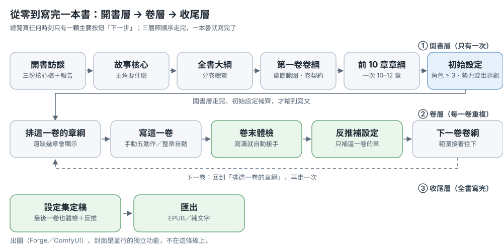
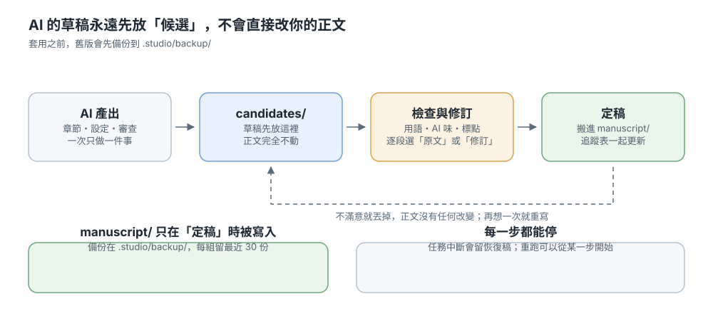
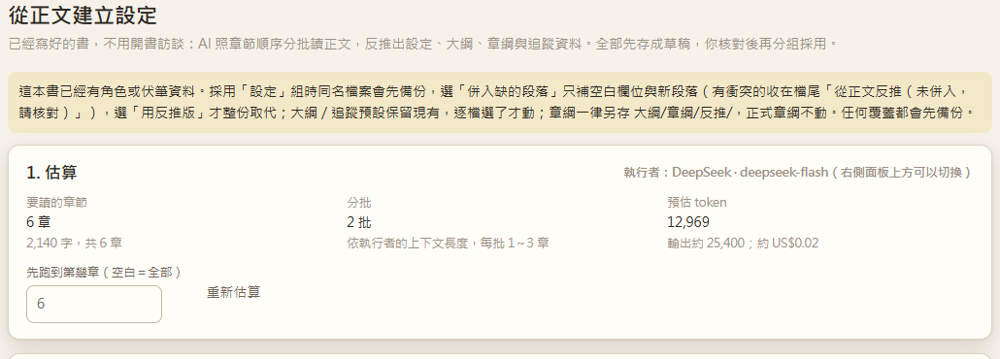
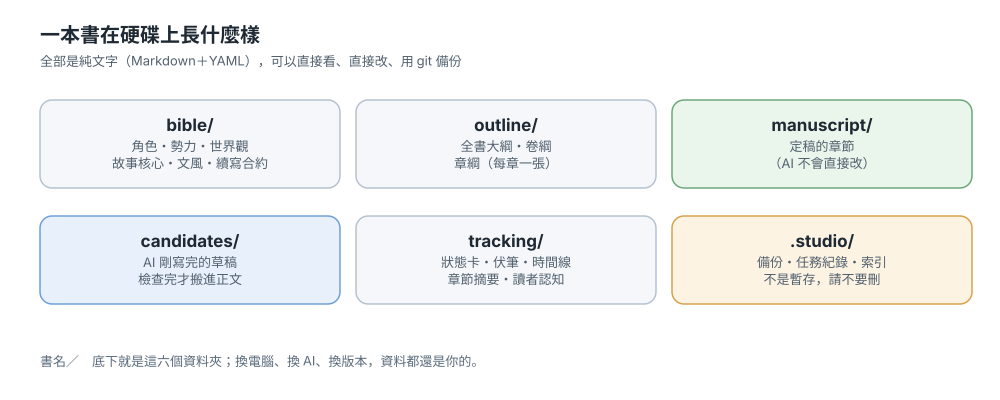

# 使い方

> Novel Studio はローカルで動く小説執筆ワークベンチです。本はフォルダ、本文は Markdown、AI は流れを代行するだけです。
> このページは静的な説明です。まず「2つの流れ」を読み、用語が分からないときは最後の用語集を見てください。

## いま何をしたいですか？

| したいこと | 行き先 |
|---|---|
| ゼロから一冊書き上げる | 流れ1：ゼロから一冊書き上げる |
| 書きかけの原稿をプロジェクトにする | 流れ2 A：古い原稿を取り込む |
| 古い本の骨組みから新しい本を作る | 流れ2 B：新しい本へ派生させる |
| 人物・勢力・世界観を作る | 設定集の育て方 |
| 用語を調べる | 用語集 |
| どのボタンが正しいか知りたい | 入口の重複（今は複数の入口がある機能があります） |

## 画面の地図

- **本棚**（左側の一番上、または `#/`）：すべての本、新規作成、古い原稿の取り込み
- **本の中の左側**：概要、章、あらすじ、設定集、伏線と年表、ジョブ、挿絵、書き出し
- **右パネル**：AI 実行環境、アクションのフォーム、ジョブのストリーム、返信欄
- **右下**：表示言語。実際のモデルと書庫の場所は「設定」にあります

---

## 流れ1：ゼロから一冊書き上げる

> 一本の線を三層で進みます：**作成層**（一度だけ）→ **巻層**（一巻ごとに繰り返す）→ **仕上げ層**（最後の章のあと）。
> どの時点でも概要ページの主ボタンは「**次のステップ**」の一つだけ。押せばいい。ほかのボタンはすべて副次です。

*上の図：本を書く三層。作成層は一度だけ、巻層は一巻ごとに繰り返し、仕上げ層は最後の章のあと。図と画面写真は中国語（繁体字）の画面です。本文に各ボタンの意味を書いています。*

### 作成層（一度だけ）

#### ステップ0：新しい本を作る

本棚 →「新しい本」：

| 項目 | 目安 |
|---|---|
| 書名 | フォルダ名にもなります。あとで変えるならフォルダも自分で変える |
| ひとことの構想 | ひとことで十分。続きはインタビューが聞きます |
| 執筆言語 | プロンプトとモデル出力の言語を決めます。画面の言語とは別 |
| 詳細：参考書（任意） | 借りるのは**文体指標と章構成**（数値）だけ。名前も筋も持ち込みません |
| 詳細：あらすじの骨格も作る | 1〜2 分と数回のモデル呼び出しが増えます。下書きは `candidates/spinoff/` |

「作成を始める」を押すと**作成インタビュー**が始まります。質問は右パネルに出て、一問につきボタン一つ。自由入力もできますし、「スキップ、あなたが決めて」でモデルに既定値を使わせることもできます（レポートに「（既定）」と付きます）。三ラウンド終わると一度に書き出します：

- `CLAUDE.md`——この本の執筆憲章。AI が毎回読みます
- `bible/story-core.md`と`bible/style.md`
- パネルの**作成レポート**：どのファイルが実際にできたか、まだ空のもの、次のステップはどれか

**うまく進まないとき**：インタビューが中断（`CLAUDE.md` がない）→ 概要に「作成インタビューが未完了」と出るので「作成インタビューを続ける」を押します。Claude Code 実行者の場合は選択ボタンが出ないので、パネルが API 実行者への切り替えを案内します。

#### ステップ1：物語の核

概要 →「次のステップ：物語の核」→「物語の核を始める」。一分ほどで、主人公が何を欲しがり何に阻まれるかを固めます。

産出：`bible/story-core.md`（120 字以上、テンプレートの `<!--` コメントを埋めないと完了になりません）。

#### ステップ2：全体あらすじ

「次のステップ：全体あらすじ」→ まず**巻ごとの総覧**（各巻のテーマ、章数、巻末の状態）が出ます。気に入らなければ返信で直し、確認してからファイルに書きます。

産出：`outline/book.md`（500 字以上）。

#### ステップ3：第一巻の巻プロット

あらすじページ上部の**巻の状況カード** →「新しい巻」→ 巻号と**章範囲**を入れます（この範囲が「どの章がこの巻か」を決めます。最初は 20 章でもよく、あとで変えられます）。

1. できるのは**下書き** `outline/drafts/vol-01.md`。手で編集してもかまいません
2. 読んで「**採用**」を押すと正式な巻プロット `outline/volumes/vol-01.md` になり、状態が「確認済み」に、そして `outline/book.md` にも追記されます
3. 中の「巻契約」はこの巻が読者に約束すること。執筆時はこれが優先して注入されます

**うまく進まないとき**：正式な巻プロットは「採用」か「修正を適用」でしか書かれません。巻の状況カードが出ないのは、たいてい `outline/book.md` がまだない本です。

#### ステップ4：最初の 10 章の章カード（＋章カード検査）

1. 巻の状況カード →「この巻の章カードを並べる」：まず**一章一行の総覧**が出ます
2. 確認を返してから一章ずつファイルに書きます：`outline/chapters/ch-NNNN.md`
3. 巻の状況カード →「章カード検査」：**早すぎる登場／ネタバレ**と**長く出ていない人物**を検出。問題があれば章カードを直してから書き始めます

一度に 10〜12 章で十分。一巻分を並べ終えてからでないと書き始められない、ということはありません。

#### ステップ5：初期設定（書き始める前に）

人物・勢力・世界観が中身のある状態でないと、空の設定のまま一巻を書くことになります。**合格の判定**：`bible/characters/` に正式ファイルが 3 つ以上、かつ `bible/factions/` か `bible/world/` に 1 つ以上——**下書きは数えません**。

1. 概要 →「次のステップ：初期設定」→「初期設定を始める」（設定集の「あらすじから設定を育てる」と同じ）
2. 人物／勢力／世界観にチェック。参考の方向や参考 URL も入れられます。全体あらすじ・巻プロット・章カード一覧を読みます
3. 産出はすべて `bible/drafts/` に落ちます
4. 読んだら「**下書きを正式にする**」（次のステップカードの副ボタン）を押すと `bible/characters/`、`bible/factions/`、`bible/world/` に入ります

**うまく進まないとき**：人物が 3 つに満たなければもう一度「あらすじから設定を育てる」を回すか、設定集で手動で足します。下書きのままだと「次のステップ」は執筆に変わりません。

### 巻層（一巻ごとに繰り返す）

#### ステップ6：この巻を書く

- **手動**（一段落ずつ見たい）：章ページ「この章を書く」→ 候補稿 →「AI っぽさを消す」→「審査」→「チェックした意見で改訂」→「採用」
- **自動**（一気に流したい）：ページ上部の「⚡ 章の自動作成」、または概要の巻カード「**この巻の残りを自動で走らせる**」（範囲はこの巻の残り章で埋まっています）

*上の図：手動の五つの操作。候補稿は必ず別に置かれ、「採用」で初めて本文に入ります。*

章の自動作成の流れ：章カード → 本文を書く → 章カード照合 → AI っぽさを消す → 文体 → 審査 → 指摘をチェック → 改訂 → 適用 → 確定して追跡を書き戻す。次の場合は**ゲート**で止まります（故障ではなく、まずデータを直してください）：

- 章番号が「確認済み」のどの巻プロットの章範囲にも入っていない
- その章の章カードがまだない
- 章カードに早すぎる登場のネタバレがある

産出：下書きは `candidates/` に置かれ、「採用」で初めて `manuscript/` に入り、同時に追跡（要約、伏線、年表、人物状態、用語集）を書き戻します。

**うまく進まないとき**：どこかの手順で失敗するとその手順で止まり、直せばその手順から続けられます。一手順が 30 分を超えるか、10 分間出力がなければ自動で停止し、書けた分は**復元稿**として残ります。書き込みの前には必ず `.studio/backup/` にバックアップします。

#### ステップ7：各章のあと

- **候補稿**：章ページか単章ページで読み、「採用」で初めて本文に入ります
- **審査／改訂**：「原文／提案」を段落ごとに見て適用。残したい段落は原文のまま
- **追跡**：確定後に「伏線と年表」ページへ書き戻し
- **タスク記録**：何を走らせ、トークンをいくつ使い、いくらかかったか

#### ステップ8：巻末チェック

この巻を書き切ると（章範囲の各章に本文がそろうと）、概要の「次のステップ」が自動で「**巻末チェック**」に変わり、押すと検査ページの範囲がこの巻で埋まっています。

*上：この巻を書き切ると「次のステップ」は自動で巻末チェックになります。その下がこの巻のカードです。*

*上：検査ページの範囲はもうこの巻で埋まっています。*

1. 「検査を始める」：設定と本文を突き合わせ、章カードに届いていない章、長く出ていない人物、未回収の伏線、文体のぶれを一覧にします（ローカル計算、無料）
2. 巻プロットを直すときは「巻プロット更新の草稿を生成」→ 読んでから「巻プロットに追記」（ファイル末尾に足すだけで、元の内容は動きません）

**うまく進まないとき**：「次のステップ」がチェックのまま動かないのは、まだ検査を走らせていないか、下書きがまだ落ちていないかのどちらかです。この手順には意図的に「スキップ」がありません。

#### ステップ9：この巻の設定を逆算して補う

概要の巻カード →「**本文から設定を逆算する（この巻）**」→ 逆算ページの「第何章まで先に走らせるか」がこの巻の最終章で埋まっています。

*上：「第何章まで先に走らせるか」がこの巻の最終章で埋まり、費用の見積りが先に出ます。*

1. まず見積り（章数、分割、予想費用）を見てから実行
2. 結果はすべて下書きで、四つの組に分かれます：設定、あらすじ、章カード、追跡
3. ファイルごとに「現状を残す／逆算版を使う／欠けた段落だけ併合」を選び、「採用」で初めて正式ファイルに触れます。**章カードは必ず別名保存** `outline/chapters/_reverse/` で、正式な章カードは一字も動きません
4. 上書きの前には必ずバックアップ

#### ステップ10：次の巻を開く

チェックが終わると「次のステップ」は「**第2巻の巻プロット**」に変わります → 新しい巻 → 採用 → 章カード → 執筆 → 巻末チェック → 次の巻。本が書き上がるまでこれを繰り返します。

### 仕上げ層

最終巻も同じように巻末チェックと逆算を行えば、設定集が確定状態になります。納品するときは「書き出し」ページで EPUB かプレーンテキストを出力します。挿絵（Forge／ComfyUI）と表紙は横並びの独立した機能で、この線には含まれません。

### ファイルの場所

| 内容 | 場所 |
|---|---|
| 全体あらすじ | `outline/book.md` |
| 巻プロット | `outline/volumes/vol-NN.md`（下書きは `outline/drafts/`） |
| 章カード | `outline/chapters/ch-NNNN.md` |
| 本文 | `manuscript/ch-NNNN.md` |
| 候補稿 | `candidates/` |
| 設定 | `bible/characters/`、`bible/factions/`、`bible/world/`、下書きは `bible/drafts/` |
| 追跡 | `tracking/state-card.md`、`tracking/foreshadowing.md`、`tracking/summaries/` |
| ジョブとバックアップ | `.studio/`（ジョブ記録、バックアップ、復元稿） |

---
---

## 流れ2：古い本から始める

### A. 古い原稿をプロジェクトにする（取り込み＋逆算）

向いている場面：docx／txt の原稿がすでにあり、ここで続きを書いたり整理したい。

1. 左側「原稿のインポート」→ ファイル選択 → 章分割のプレビュー → 取り込み（新しい本を作るか、既存の本に追加）
2. その本を開く → 設定集 →「**本文から設定を作成**」：
   - 本文を分割して読み、人物、勢力、世界観、用語を抽出
   - すべてまず `bible/drafts/` と候補領域に入る
   - グループごとに確認し、「採用」で正式な設定と用語集へ
3. 必要なら「巻末チェック」で、設定に拾われていない章を確認
4. 章カードも本文から逆算できます（同じ流れの一部）。その後は前へ書き進めます

### B. 古い本から新しい本へ派生（P6：A 本 → B 本）

向いている場面：ある本の語感と構成を借りて、まったく新しい物語を書きたい。

**新しい本を作るとき：**

1. 本棚 →「＋ 新しい本」カード →「参考書」を選ぶ → 必要なら「ストーリー骨組みの草案も生成する」にチェック
2. 参考書だけ：新しい本に `bible/style.md`、`bible/structure/structure.md`、`bible/style-fingerprint.json`、`bible/structure-dna.json` が入ります（ローカル計算、モデル呼び出しなし）
3. 骨組みも生成：さらに1〜2分で**新しい**骨組みの下書き（書名案、前提、売り、主人公、世界観、巻プロット）を作り、`candidates/spinoff/` に保存
4. 骨組みは下書きで、自動適用はされません。気に入った部分を設定とあらすじへ自分で移します

**すでにある本の場合：**

あらすじページ →「**参考書から骨組み**」→ 参考書と補足を選ぶ → 同じ骨組み下書きを作成。

> 引き継ぐのは抽象的な特徴（文体、構成、視点、章のリズム）だけです。**元の本文、人物名、地名、出来事は持ち込みません。**
> 自分が権利を持つ作品かパブリックドメインの作品だけを使ってください。実行環境は API（Claude Code では不可）が必要です。

### C. 文体／構成だけ借りる

- 共用ライブラリ → 文体、章構成：ある本から測って共用テンプレートにする
- 設定集 →「核心」→「分析／調整文風」：この本の目標を調整
- P6 の「参考書」も同じ考え方で、新しい本を作るときに使います

---

## 設定集の育て方

設定集は静的な設定（人物、勢力、世界観、用語集）です。人物が**今どこにいて、傷はどうで、何を知っているか**は「伏線と年表」にあります。

設定集の右上にある **「設定を生成」** を押すと、まず手元に何があるかを聞かれます：あらすじ／巻プロットがある、一文かキーワードだけ、議論した文章がある、足りない項目が1つだけ、のどれかです。

| 方法 | 使うとき | 出力 |
|---|---|---|
| **あらすじから設定を育てる** | あらすじはあるが設定が空 | 人物・勢力・世界観の下書き（範囲選択、参考方向と URL を指定可） |
| **設定の下書きを生成（自由記述）** | 欲しいものがはっきりしている | 下書き |
| **内容をプロジェクトに整理（テキストを貼る）** | AI と議論して長い文章がある | 確定分は正式、検討中は下書き |
| **生成設定 → 足りない項目が1つだけ**（人物／勢力／世界観） | 1項目だけ足りない | 単項目 |
| **本文から設定を作成** | 本文があり逆算したい | 下書き、グループごとに採用 |

下書きはすべて `bible/drafts/` にあります。確認したら「**下書きを正式にする**」で登録し、用語集はその段階で更新されます。

### あらすじから設定を育てる（新しい方法）

設定集 →「設定を生成」→「大綱や巻プロットがもうある」：

- 育てる種類にチェック（人物／勢力／世界観）
- 「参考の方向」を入力可。例：「空中艦の戦いを第二次大戦の潜水艦戦術に寄せる」
- 「参考 URL」を入力可：ページ本文を取得してプロンプトに入れます（最大3ページ、各6,000字）
- 読むもの：全体あらすじ、すべての巻プロット、章カード一覧（最初の60章）、既存設定の索引、物語の核、文体、作者の好み、状態カード
- 出力：人物（初登場章つき）、勢力、世界観の下書き

> 検索エンジンではありません。AI が自分でネットを探すことはありません。URL はこちらで用意してください。URL が無い場合は、AI の知識と「參考方向」だけで書きます。

---

## 用語集

| 用語 | 意味 |
|---|---|
| **あらすじ** | 全体の計画。全体あらすじと各巻の巻プロットを含む |
| **全体あらすじ** | 巻ごとの概要：テーマ、章数、巻末の状態。`outline/book.md` |
| **巻プロット** | 1巻の計画：主線、巻の約束、巻末で必ず達する状態 |
| **巻の約束** | この巻が読者に約束すること（起きること／起きないこと）。続きを書くとき最初に渡される |
| **章カード** | 1章の計画：場面、出来事、出る人物、引き |
| **章カード検査** | 章カードの「早すぎる登場／ネタバレ」と「長く出ていない人物」を点検 |
| **初期設定** | 作成層の最後の手順：`bible/characters/` に正式ファイルが 3 つ以上、かつ `bible/factions/` か `bible/world/` に 1 つ以上。下書きは数えない |
| **巻末チェック** | 一巻を書き切ったあと、設定と本文を突き合わせる：届いていない章カード、長く出ていない人物、未回収の伏線、文体のぶれ。巻プロット更新の下書きも作れる |
| **次のステップ** | 概要ページの唯一の主ボタン。押すとこの流れの次の作業が始まる |
| **続き書きの契約** | `bible/continuation-contract.md`。変えてはいけない事実と巻末の約束。あらすじや文体より優先 |
| **状態カード** | 人物の現在地、傷、何を知っているか。各章の確定後に書き戻す |
| **伏線** | 伏線。長く出てこない、回収予定を過ぎたときに知らせる |
| **読者の認知** | 読者が何を知っていて何を知らないか（読者が既に知っていることを人物に言わせない） |
| **ずれ** | 設定と本文が少しずつずれること。巻末チェックで見つける |
| **文体指標** | セリフ比率、文の長さ、段落の長さなどの数値 |
| **文体の指紋** | ある本から測った文体の数値＋代表文（人名は伏せ字） |
| **構造 DNA** | 視点、章の長さの分布、セリフのリズム、章長カーブなどの抽象構造 |
| **回帰テスト** | `book_eval`。固定サンプルで、プロンプトやモデルの変更が品質を下げていないか確認 |
| **自動運転** | K章ごとに止まり、「必ず直す」項目と文体を確認してから続行 |
| **検索型の記憶** | 新しい章を書くとき、前の章から関連する段落を検索して文脈に入れる |
| **候補稿** | まだ確定していない本文。`candidates/` にあり、確認後に `manuscript/` へ |

---

## よくある質問

**「整章自動」（章まるごと自動）が拒否された。**
よくある原因：章番号が確認済みの巻プロットの範囲外、その章の章カードが無い、章カードに早すぎる登場がある。巻プロットや章カードを直すか、章番号を変えてください。

**巻の状況カードが出ない。**
巻の状況はあらすじページにだけあります。全体あらすじすら無い本なら、先に「全体あらすじ」を作ってください。

**参考 URL が取得できない。**
取得するのは `http/https` のみ、最大3ページ、各6,000字。403 やタイムアウトはプロンプトに「抓取失敗」（取得失敗）と書かれ、その他は普通に生成されます。

**Claude Code では骨組みを作れない？**
骨組みは API の実行環境（例：DeepSeek）が必要です。右パネルの上で切り替えてください。Claude Code はワークベンチ自身の流れだけで使います。

**ジョブはどこで見る？**
右パネルがリアルタイムのストリームです。終わった実行は「タスク履歴」にトークン数と費用つきで残ります。

**壊してしまった。**
書き込みの前に必ずバックアップがあります（`.studio/backup/`）。復元稿もあります。ジョブページでどのステップで失敗したか分かります。

---

## 入口の重複

今、いくつかの機能には複数の入口があります（例：「章カードを作成」のボタンが5つ、設定生成が4通り）。
巻プロットはすでに一本化しました：新しい巻は「新しい巻を作る → 採用」、既存の巻は「修正 → 差分を見る → 修正を適用」。
完全な一覧と整理案はプロジェクトの `docs/入口檢查.md` にあります。**他の流れは今は記録だけで、変えていません**。
