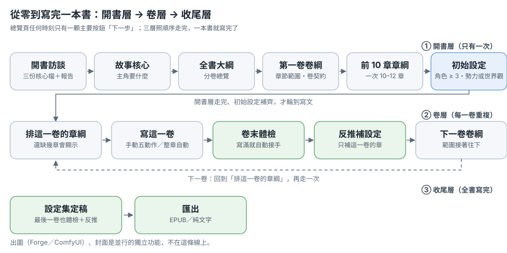
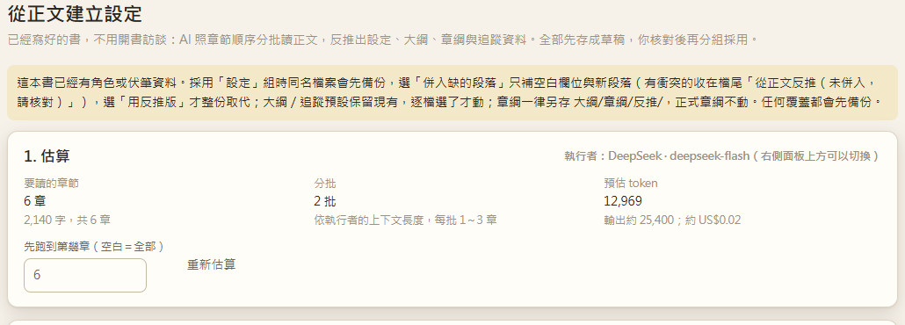
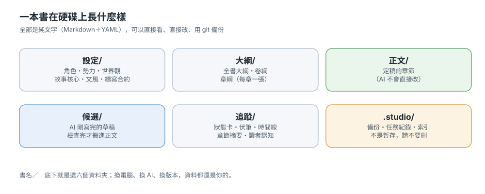

# 使い方

> Novel Studio はローカルで動く小説執筆ワークベンチです。本はフォルダ、本文は Markdown、AI は流れを代行するだけです。
> このページは静的な説明です。まず「2つの流れ」を読み、用語が分からないときは最後の用語集を見てください。

## いま何をしたいですか？

| したいこと | 行き先 |
|---|---|
| ゼロから一冊書き上げる | 流れ1：ゼロから一冊書き上げる |
| 書きかけの原稿をプロジェクトにする | 流れ2 A：古い原稿を取り込む |
| 古い本の骨組みから新しい本を作る | 流れ2 B：新しい本へ派生させる |
| 人物・勢力・世界観を作る | 設定集の育て方 |
| 用語を調べる | 用語集 |
| どのボタンが正しいか知りたい | 入口の重複（今は複数の入口がある機能があります） |

## 画面の地図

- **本棚**（左側の一番上、または `#/`）：すべての本、新規作成、古い原稿の取り込み
- **本の中の左側**：概要、章、大綱、設定集、伏線とタイムライン、ジョブ、挿絵、書き出し
- **右パネル**：AI 実行環境、アクションのフォーム、ジョブのストリーム、返信欄
- **右下**：表示言語。実際のモデルと書庫の場所は「設定」にあります

---

## 流れ1：ゼロから一冊書き上げる

> 一本の線を三層で進みます：**開書層**（一度だけ）→ **巻層**（一巻ごとに繰り返す）→ **仕上げ層**（最後の章のあと）。
> どの時点でも概要ページの主ボタンは「**次の一歩**」の一つだけ。押せばいい。ほかのボタンはすべて副次です。

*上の図：本を書く三層。開書層は一度だけ、巻層は一巻ごとに繰り返し、仕上げ層は最後の章のあと。図と画面写真は中国語（繁体字）の画面です。本文に各ボタンの意味を書いています。*

### 開書層（一度だけ）

#### ステップ0：新しい本を作る

本棚 →「新しい本」：

| 項目 | 目安 |
|---|---|
| 書名 | フォルダ名にもなります。あとで変えるならフォルダも自分で変える |
| ひとことの構想 | ひとことで十分。続きはインタビューが聞きます |
| 執筆言語 | プロンプトとモデル出力の言語を決めます。画面の言語とは別 |
| 詳細：参考書（任意） | 借りるのは**文体指標と章構成**（数値）だけ。名前も筋も持ち込みません |
| 詳細：あらすじの骨格も作る | 1〜2 分と数回のモデル呼び出しが増えます。草稿は `候選/新書草稿/` |

「開書を始める」を押すと**開書インタビュー**が始まります。質問は右パネルに出て、一問につきボタン一つ。自由入力もできますし、「スキップ、あなたが決めて」でモデルに既定値を使わせることもできます（レポートに「（既定）」と付きます）。三ラウンド終わると一度に書き出します：

- `CLAUDE.md`——この本の執筆憲章。AI が毎回読みます
- `設定/故事核心.md`と`設定/文風.md`
- パネルの**開書レポート**：どのファイルが実際にできたか、まだ空のもの、次の一歩はどれか

**うまく進まないとき**：インタビューが中断（`CLAUDE.md` がない）→ 概要に「開書インタビューが未完了」と出るので「開書インタビューを続ける」を押します。Claude Code 実行者の場合は選択ボタンが出ないので、パネルが API 実行者への切り替えを案内します。

#### ステップ1：物語の芯

概要 →「次の一歩：物語の芯」→「物語の芯を診断」。一分ほどで、主人公が何を欲しがり何に阻まれるかを固めます。

産出：`設定/故事核心.md`（120 字以上、テンプレートの `<!--` コメントを埋めないと完了になりません）。

#### ステップ2：全体のあらすじ

「次の一歩：全体のあらすじ」→ まず**巻ごとの総覧**（各巻のテーマ、章数、巻末の状態）が出ます。気に入らなければ返信で直し、確認してからファイルに書きます。

産出：`大綱/全書大綱.md`（500 字以上）。

#### ステップ3：第一巻のあらすじ

あらすじページ上部の**巻況カード** →「新しい巻」→ 巻号と**章範囲**を入れます（この範囲が「どの章がこの巻か」を決めます。最初は 20 章でもよく、あとで変えられます）。

1. できるのは**草稿** `大綱/草稿/卷綱_第1卷.md`。手で編集してもかまいません
2. 読んで「**採用**」を押すと正式な巻あらすじ `大綱/卷綱_第1卷.md` になり、状態が「已確認」に、そして `大綱/全書大綱.md` にも追記されます
3. 中の「巻契約」はこの巻が読者に約束すること。執筆時はこれが優先して注入されます

**うまく進まないとき**：正式な巻あらすじは「採用」か「修訂を適用」でしか書かれません。巻況カードが出ないのは、たいてい `大綱/全書大綱.md` がまだない本です。

#### ステップ4：最初の 10 章の章カード（＋章カード検査）

1. 巻況カード →「この巻の章カードを並べる」：まず**一章一行の総覧**が出ます
2. 確認を返してから一章ずつファイルに書きます：`大綱/章綱/第NNN章_*.md`
3. 巻況カード →「章カード検査」：**早すぎる登場／ネタバレ**と**長く出ていない人物**を検出。問題があれば章カードを直してから書き始めます

一度に 10〜12 章で十分。一巻分を並べ終えてからでないと書き始められない、ということはありません。

#### ステップ5：初期設定（書き始める前に）

人物・勢力・世界観が中身のある状態でないと、空の設定のまま一巻を書くことになります。**合格の判定**：`設定/角色/` に正式ファイルが 3 つ以上、かつ `設定/勢力/` か `設定/世界観/` に 1 つ以上——**草稿は数えません**。

1. 概要 →「次の一歩：初期設定」→「初期設定を始める」（設定集の「あらすじから設定を育てる」と同じ）
2. 人物／勢力／世界観にチェック。参考の方向や参考 URL も入れられます。全体のあらすじ・巻あらすじ・章カード一覧を読みます
3. 産出はすべて `設定/草稿/` に落ちます
4. 読んだら「**草稿を正式にする**」（次の一歩カードの副ボタン）を押すと `設定/角色/`、`設定/勢力/`、`設定/世界観/` に入ります

**うまく進まないとき**：人物が 3 つに満たなければもう一度「あらすじから設定を育てる」を回すか、設定集で手動で足します。草稿のままだと「次の一歩」は執筆に変わりません。

### 巻層（一巻ごとに繰り返す）

#### ステップ6：この巻を書く

- **手動**（一段落ずつ見たい）：章ページ「この章を書く」→ 候補稿 →「AI っぽさを消す」→「審査」→「チェックした意見で改訂」→「採用」
- **自動**（一気に流したい）：ページ上部の「⚡ 章の自動作成」、または概要の巻カード「**この巻の残りを自動で走らせる**」（範囲はこの巻の残り章で埋まっています）

*上の図：手動の五つの操作。候補稿は必ず別に置かれ、「採用」で初めて本文に入ります。*

章の自動作成の流れ：章カード → 本文を書く → 綱と照合 → AI っぽさを消す → 文体 → 審査 → 指摘をチェック → 改訂 → 適用 → 確定して追跡を書き戻す。次の場合は**ゲート**で止まります（故障ではなく、まずデータを直してください）：

- 章番号が「已確認」のどの巻あらすじの章範囲にも入っていない
- その章の章カードがまだない
- 章カードに早すぎる登場のネタバレがある

産出：草稿は `候補/` に置かれ、「採用」で初めて `正文/` に入り、同時に追跡（要約、伏線、時間線、人物状態、用語表）を書き戻します。

**うまく進まないとき**：どこかの手順で失敗するとその手順で止まり、直せばその手順から続けられます。一手順が 30 分を超えるか、10 分間出力がなければ自動で停止し、書けた分は**復元稿**として残ります。書き込みの前には必ず `.studio/備份/` にバックアップします。

#### ステップ7：各章のあと

- **候補稿**：章ページか単章ページで読み、「採用」で初めて本文に入ります
- **審査／改訂**：「原文／提案」を段落ごとに見て適用。残したい段落は原文のまま
- **追跡**：確定後に「伏線と時間線」ページへ書き戻し
- **タスク記録**：何を走らせ、トークンをいくつ使い、いくらかかったか

#### ステップ8：巻末チェック

この巻を書き切ると（章範囲の各章に本文がそろうと）、概要の「次の一歩」が自動で「**巻末チェック**」に変わり、押すと検査ページの範囲がこの巻で埋まっています。

*上：この巻を書き切ると「次の一歩」は自動で巻末チェックになります。その下がこの巻のカードです。*

*上：検査ページの範囲はもうこの巻で埋まっています。*

1. 「検査を始める」：設定と本文を突き合わせ、章カードに届いていない章、長く出ていない人物、未回収の伏線、文体のぶれを一覧にします（ローカル計算、無料）
2. 巻あらすじを直すときは「巻あらすじ更新の草稿を作る」→ 読んでから「巻あらすじに追記」（ファイル末尾に足すだけで、元の内容は動きません）

**うまく進まないとき**：「次の一歩」がチェックのまま動かないのは、まだ検査を走らせていないか、草稿がまだ落ちていないかのどちらかです。この手順には意図的に「スキップ」がありません。

#### ステップ9：この巻の設定を逆算して補う

概要の巻カード →「**本文から設定を逆算する（この巻）**」→ 逆算ページの「第何章まで先に走らせるか」がこの巻の最終章で埋まっています。

*上：「第何章まで先に走らせるか」がこの巻の最終章で埋まり、費用の見積りが先に出ます。*

1. まず見積り（章数、分割、予想費用）を見てから実行
2. 結果はすべて草稿で、四つの組に分かれます：設定、あらすじ、章カード、追跡
3. ファイルごとに「現状を残す／逆算版を使う／欠けた段落だけ併合」を選び、「採用」で初めて正式ファイルに触れます。**章カードは必ず別名保存** `大綱/章綱/反推/` で、正式な章カードは一字も動きません
4. 上書きの前には必ずバックアップ

#### ステップ10：次の巻を開く

チェックが終わると「次の一歩」は「**第二巻のあらすじ**」に変わります → 新しい巻 → 採用 → 章カード → 執筆 → 巻末チェック → 次の巻。本が書き上がるまでこれを繰り返します。

### 仕上げ層

最終巻も同じように巻末チェックと逆算を行えば、設定集が確定状態になります。納品するときは「書き出し」ページで EPUB かプレーンテキストを出力します。挿絵（Forge／ComfyUI）と表紙は横並びの独立した機能で、この線には含まれません。

### ファイルの場所

| 内容 | 場所 |
|---|---|
| 全書大綱 | `大綱/全書大綱.md` |
| 卷綱 | `大綱/卷綱_第N卷.md`（草稿は `大綱/草稿/`） |
| 章カード | `大綱/章綱/第NNN章_*.md` |
| 本文 | `正文/第NNN章_*.md` |
| 候補稿 | `候選/` |
| 設定 | `設定/角色/`、`設定/勢力/`、`設定/世界觀/`、草稿は `設定/草稿/` |
| 追跡 | `追蹤/狀態卡.md`、`追蹤/伏筆.md`、`追蹤/章節摘要/` |
| ジョブとバックアップ | `.studio/`（ジョブ記録、バックアップ、復元稿） |

---
---

## 流れ2：古い本から始める

### A. 古い原稿をプロジェクトにする（取り込み＋逆算）

向いている場面：docx／txt の原稿がすでにあり、ここで続きを書いたり整理したい。

1. 左側「匯入舊稿」（古い原稿を取り込む）→ ファイル選択 → 章分割のプレビュー → 取り込み（新しい本を作るか、既存の本に追加）
2. その本を開く → 設定集 →「**從正文建立設定**」（本文から設定を作る）：
   - 本文を分割して読み、人物、勢力、世界観、用語を抽出
   - すべてまず `設定/草稿/` と候補領域に入る
   - グループごとに確認し、「採用」（採用）で正式な設定と用語表へ
3. 必要なら「卷末體檢」（巻末点検）で、設定に拾われていない章を確認
4. 章カードも本文から逆算できます（同じ流れの一部）。その後は前へ書き進めます

### B. 古い本から新しい本へ派生（P6：A 本 → B 本）

向いている場面：ある本の語感と構成を借りて、まったく新しい物語を書きたい。

**新しい本を作るとき：**

1. 本棚 →「＋ 開新書」→「參考書」（参考書）を選ぶ → 必要なら「順便產生故事骨架」（物語の骨組みも生成）にチェック
2. 参考書だけ：新しい本に `設定/文風.md`、`設定/章節結構/結構.md`、`設定/風格指紋.json`、`設定/結構DNA.json` が入ります（ローカル計算、モデル呼び出しなし）
3. 骨組みも生成：さらに1〜2分で**新しい**骨組みの草稿（書名案、前提、売り、主人公、世界観、巻綱）を作り、`候選/新書草稿/` に保存
4. 骨組みは草稿で、自動適用はされません。気に入った部分を設定と大綱へ自分で移します

**すでにある本の場合：**

大綱ページ →「**參考書骨架**」（参考書から骨組み）→ 参考書と補足を選ぶ → 同じ骨組み草稿を作成。

> 引き継ぐのは抽象的な特徴（文体、構成、視点、章のリズム）だけです。**元の本文、人物名、地名、出来事は持ち込みません。**
> 自分が権利を持つ作品かパブリックドメインの作品だけを使ってください。実行環境は API（Claude Code では不可）が必要です。

### C. 文体／構成だけ借りる

- 共用ライブラリ → 文体、章構成：ある本から測って共用テンプレートにする
- 設定集 →「核心」→「分析／調整文風」：この本の目標を調整
- P6 の「参考書」も同じ考え方で、新しい本を作るときに使います

---

## 設定集の育て方

設定集は静的な設定（人物、勢力、世界観、用語表）です。人物が**今どこにいて、傷はどうで、何を知っているか**は「伏線とタイムライン」にあります。

設定集の右上にある **「生成設定」** を押すと、まず手元に何があるかを聞かれます：大綱／巻プロットがある、一文かキーワードだけ、議論した文章がある、足りない項目が1つだけ、のどれかです。

| 方法 | 使うとき | 出力 |
|---|---|---|
| **從大綱長設定**（大綱から設定を育てる） | 大綱はあるが設定が空 | 人物・勢力・世界観の草稿（範囲選択、参考方向と URL を指定可） |
| **生成設定草稿**（設定の草稿を生成） | 欲しいものがはっきりしている | 草稿 |
| **整理內容入庫**（内容をプロジェクトに整理） | AI と議論して長い文章がある | 確定分は正式、検討中は草稿 |
| **生成設定 → 足りない項目が1つだけ**（人物／勢力／世界観） | 1項目だけ足りない | 単項目 |
| **從正文建立設定**（本文から設定を作る） | 本文があり逆算したい | 草稿、グループごとに採用 |

草稿はすべて `設定/草稿/` にあります。確認したら「**草稿轉正式**」（草稿を正式へ）で登録し、用語表はその段階で更新されます。

### 大綱から設定を育てる（新しい方法）

設定集 →「生成設定」→「我已經有大綱或卷綱」：

- 育てる種類にチェック（人物／勢力／世界観）
- 「參考方向」（参考にしたい方向）を入力可。例：「空中艦の戦いを第二次大戦の潜水艦戦術に寄せる」
- 「參考網址」（参考 URL）を入力可：ページ本文を取得してプロンプトに入れます（最大3ページ、各6,000字）
- 読むもの：全書大綱、すべての卷綱、章カード一覧（最初の60章）、既存設定の索引、故事核心、文体、作者の好み、狀態卡
- 出力：人物（初登場章つき）、勢力、世界観の草稿

> 検索エンジンではありません。AI が自分でネットを探すことはありません。URL はこちらで用意してください。URL が無い場合は、AI の知識と「參考方向」だけで書きます。

---

## 用語集

| 用語 | 意味 |
|---|---|
| **大綱（outline）** | 全体の計画。全書大綱と各巻の巻綱を含む |
| **全書大綱（whole-book outline）** | 巻ごとの概要：テーマ、章数、巻末の状態。`大綱/全書大綱.md` |
| **卷綱（volume outline）** | 1巻の計画：主線、卷契約、巻末で必ず達する状態 |
| **卷契約（volume contract）** | この巻が読者に約束すること（起きること／起きないこと）。続きを書くとき最初に渡される |
| **章綱（chapter card）** | 1章の計画：場面、出来事、出る人物、引き |
| **章綱體檢（chapter-card health check）** | 章カードの「早すぎる登場／ネタバレ」と「長く出ていない人物」を点検 |
| **初始設定（initial settings）** | 開書層の最後の手順：`設定/角色/` に正式ファイルが 3 つ以上、かつ `設定/勢力/` か `設定/世界観/` に 1 つ以上。草稿は数えない |
| **巻末チェック（end-of-volume check）** | 一巻を書き切ったあと、設定と本文を突き合わせる：届いていない章カード、長く出ていない人物、未回収の伏線、文体のぶれ。巻あらすじ更新の草稿も作れる |
| **次の一歩（next step）** | 概要ページの唯一の主ボタン。押すとこの流れの次の作業が始まる |
| **續寫合約（continuation contract）** | `設定/續寫合約.md`。変えてはいけない事実と巻末の約束。大綱や文体より優先 |
| **狀態卡（state card）** | 人物の現在地、傷、何を知っているか。各章の確定後に書き戻す |
| **伏筆（foreshadowing）** | 伏線。長く出てこない、回収予定を過ぎたときに知らせる |
| **讀者認知（reader knowledge）** | 読者が何を知っていて何を知らないか（読者が既に知っていることを人物に言わせない） |
| **漂移（drift）** | 設定と本文が少しずつずれること。巻末点検で見つける |
| **文風指標（style metrics）** | セリフ比率、文の長さ、段落の長さなどの数値 |
| **風格指紋（style fingerprint）** | ある本から測った文体の数値＋代表文（人名は伏せ字） |
| **結構DNA（structure DNA）** | 視点、章の長さの分布、セリフのリズム、章長カーブなどの抽象構造 |
| **回歸測試（regression eval）** | `book_eval`。固定サンプルで、プロンプトやモデルの変更が品質を下げていないか確認 |
| **自動駕駛（autopilot）** | K章ごとに止まり、「必ず直す」項目と文体を確認してから続行 |
| **檢索式記憶（retrieval memory）** | 新しい章を書くとき、前の章から関連する段落を検索して文脈に入れる |
| **候補稿（candidate draft）** | まだ確定していない本文。`候選/` にあり、確認後に `正文/` へ |

---

## よくある質問

**「整章自動」（章まるごと自動）が拒否された。**
よくある原因：章番号が確認済みの卷綱の範囲外、その章の章カードが無い、章カードに早すぎる登場がある。卷綱や章カードを直すか、章番号を変えてください。

**卷況カードが出ない。**
卷況は大綱ページにだけあります。全書大綱すら無い本なら、先に「全書大綱」を作ってください。

**参考 URL が取得できない。**
取得するのは `http/https` のみ、最大3ページ、各6,000字。403 やタイムアウトはプロンプトに「抓取失敗」（取得失敗）と書かれ、その他は普通に生成されます。

**Claude Code では骨組みを作れない？**
骨組みは API の実行環境（例：DeepSeek）が必要です。右パネルの上で切り替えてください。Claude Code はワークベンチ自身の流れだけで使います。

**ジョブはどこで見る？**
右パネルがリアルタイムのストリームです。終わった実行は「任務紀錄」（ジョブ）にトークン数と費用つきで残ります。

**壊してしまった。**
書き込みの前に必ずバックアップがあります（`.studio/備份/`）。復元稿もあります。ジョブページでどのステップで失敗したか分かります。

---

## 入口の重複

今、いくつかの機能には複数の入口があります（例：「排章綱」のボタンが5つ、設定生成が4通り）。
巻プロットはすでに一本化しました：新しい巻は「開新卷 → 採用」、既存の巻は「修訂 → 看差異 → 套用修訂」。
完全な一覧と整理案はプロジェクトの `docs/入口檢查.md` にあります。**他の流れは今は記録だけで、変えていません**。
