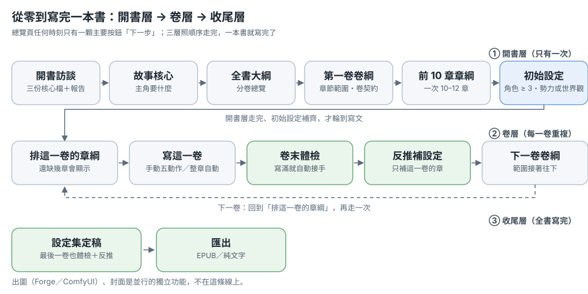
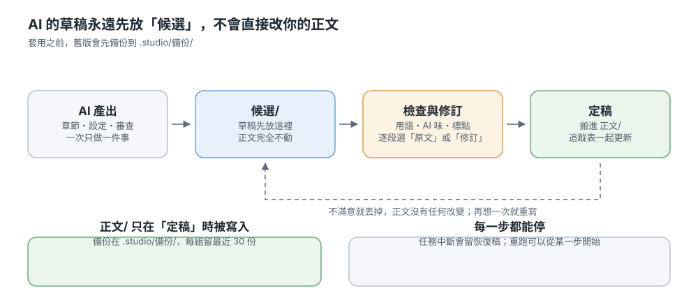
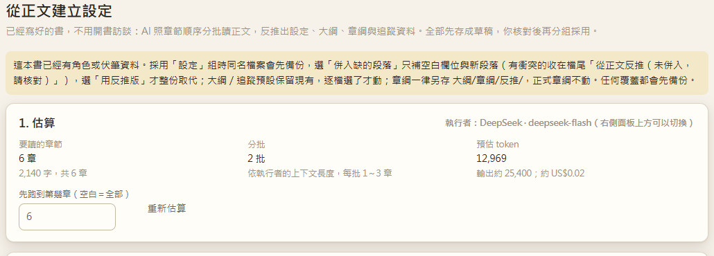

# 使用說明

> Novel Studio 是本機的小說寫作工作台：書是資料夾、正文是 Markdown，AI 只是幫你跑流程。
> 這頁是靜態教學，先看「兩個流程」，遇到名詞再查最後的名詞表。

## 你現在想做什麼？

| 我想… | 去哪 |
|---|---|
| 開一本全新的書 | 流程一：從零寫完一本書 |
| 把已經寫好的舊稿變成專案 | 流程二 A：匯入舊稿 |
| 用舊書的骨架另開一本新書 | 流程二 B：從舊書延伸新書 |
| 生出角色、勢力、世界觀 | 設定集怎麼長出來 |
| 看不懂某個名詞 | 名詞表 |
| 想知道哪個按鈕才是對的 | 入口重複整理（有些功能目前有多個入口） |

## 介面地圖

- **書架**（左側最上或 `#/`）：所有書、開新書、匯入舊稿
- **一本書的左側**：總覽、章節、大綱、設定集、伏筆與時間線、任務紀錄、插圖、匯出
- **右側面板**：AI 執行者、動作表單、任務串流、回覆框
- **右下角**：介面語言；實際的模型與書庫位置在「設定」

---

## 流程一：從零寫完一本書

> 一條線分三層：**開書層**（只有一次）→ **卷層**（每一卷重複）→ **收尾層**（全書寫完）。
> 任何時刻總覽頁只有一顆主要按鈕「**下一步**」——按它就對了，其他按鈕都是次要的。

*上圖：一本書的三層。開書層只有一次，卷層每一卷重複，收尾層在全書寫完之後。*

### 開書層（只有一次）

#### 步驟 0：開一本新書

書架 →「＋ 開新書」：

| 欄位 | 建議 |
|---|---|
| 書名 | 也是資料夾名稱，之後改名要自己改資料夾 |
| 一句話構想 | 一句就好，訪談會接著問 |
| 寫作語言 | 決定提示詞與模型輸出的語言，和介面語言無關 |
| 進階：參考書（選填） | 只沿用它的**文風指標與章節結構**（數字），不會帶名字或情節 |
| 進階：順便產生故事骨架 | 勾了會多花約 1–2 分鐘、幾次模型呼叫，草稿在 `候選/新書草稿/` |

按「開始開書」後會自動跑**開書訪談**：題目在右側面板，一題一顆按鈕，也可以直接打字，或按「跳過，你決定」讓模型用預設（報告會標「（預設）」）。三輪問完，一次寫出：

- `CLAUDE.md`——這本書的寫作公約，AI 每次任務都會讀
- `設定/故事核心.md`、`設定/文風.md`
- 面板上的**開書完成報告**：哪些檔真的建立了、還空著什麼、下一步是哪一顆

**卡住時**：訪談中斷（沒有 `CLAUDE.md`）→ 總覽會說「開書訪談還沒完成」，按「繼續開書訪談」。用 Claude Code 執行者時沒有選項按鈕，面板會提示切到 API 執行者。

#### 步驟 1：故事核心

總覽 →「下一步：故事核心」→「開始故事核心診斷」。大約一分鐘：主角要什麼、被什麼擋住。

產出：`設定/故事核心.md`（≥ 120 字，範本註解 `<!--` 要填掉才算過關）。

#### 步驟 2：全書大綱

「下一步：全書大綱」→ 先給**分卷總覽**（每卷主題、章數、卷末狀態），不滿意就直接回覆意見，確認後才寫檔。

產出：`大綱/全書大綱.md`（≥ 500 字）。

#### 步驟 3：第一卷卷綱

大綱頁上方的**卷況卡** →「開新卷」→ 填卷號與**章節範圍**（這個範圍之後決定「哪幾章算這一卷」，先填 20 章也行，之後可以改）。

1. 產生的是**草稿** `大綱/草稿/卷綱_第1卷.md`，可以直接編輯
2. 看過按「**採用**」→ 搬成正式卷綱 `大綱/卷綱_第1卷.md`、狀態改「已確認」，並自動把這一卷補進 `大綱/全書大綱.md`
3. 卷綱裡的「卷契約」＝這一卷對讀者的承諾，續寫時優先注入

**卡住時**：正式卷綱只會由「採用」或「套用修訂」寫入；卷況卡沒出現，通常是這本書連 `大綱/全書大綱.md` 都還沒有。

#### 步驟 4：前 10 章章綱（＋章綱體檢）

1. 卷況卡 →「排這一卷的章綱」：先給**一章一行的總覽**
2. 看過回覆「確認」才逐章寫檔：`大綱/章綱/第NNN章_*.md`
3. 卷況卡 →「章綱體檢」：抓**提前登場／劇透**與**角色久別重逢**；有問題先改章綱再開寫

一次排 10–12 章就夠，不用整卷排完才動筆。

#### 步驟 5：初始設定（寫文之前）

角色、勢力、世界觀至少要像樣，才不會拿空設定寫一整卷。**過關判定**：`設定/角色/` 至少 3 個正式檔，且 `設定/勢力/` 或 `設定/世界觀/` 至少一個——**草稿不算完成**。

1. 總覽 →「下一步：初始設定」→「開始初始設定」（就是設定集的「從大綱長設定」）
2. 勾角色／勢力／世界觀，可填參考方向與參考網址；它會讀全書大綱、卷綱、章綱清單
3. 產出全部落在 `設定/草稿/`
4. 看過後按「**草稿轉正式**」（下一步卡上的次要按鈕）才會進 `設定/角色/`、`設定/勢力/`、`設定/世界觀/`

**卡住時**：角色不到 3 個就再跑一次「從大綱長設定」，或到設定集手動新增／補完。只停在草稿的話，「下一步」不會換成寫文。

### 卷層（每一卷重複）

#### 步驟 6：寫這一卷

- **手動**（想逐段盯）：章節頁「寫這章」→ 候選稿 →「去 AI 味」→「審查」→「依勾選意見修訂」→「採用」
- **自動**（想一次跑完）：頁首「⚡ 整章自動」，或總覽卷卡「**這一卷剩下的用自動跑**」（範圍已帶好這一卷剩下的章）

*上圖：手動的五個動作。候選稿永遠先放旁邊，按「採用」才進正文。*

整章自動的管線：章綱 → 寫正文 → 對綱 → 去 AI 味 → 文風 → 審查 → 勾選問題 → 修訂 → 套用 → 定稿回寫。以下情況會被**閘門**擋下（不是壞掉，是叫你先把資料補好）：

- 章號不在任何「已確認」卷綱的章節範圍內
- 這一章還沒有章綱
- 章綱有提前登場的劇透

產出：草稿在 `候選/`，按「採用」才進 `正文/`，同時回寫追蹤（摘要、伏筆、時間線、角色狀態、名詞表）。

**卡住時**：某一步失敗會停在那一步，修好後可以從那一步繼續；一步超過 30 分鐘或 10 分鐘沒有輸出會自動停並留**恢復稿**；每個寫入前都有 `.studio/備份/`。

#### 步驟 7：每章之後

- **候選稿**：在章節頁或單章頁審閱，滿意才「採用」
- **審查／修訂**：逐段看「原文／建議」再套用，不滿意的段落留在原文
- **追蹤**：定稿後回寫到「伏筆與時間線」頁
- **任務紀錄**：每次跑了什麼、花多少 token 都在那裡

#### 步驟 8：卷末體檢

這一卷寫滿（章節範圍內每章都有正文）之後，總覽的「下一步」會自動變成「**卷末體檢**」，按下去體檢頁的範圍已經填成這一卷。

*上圖：這一卷寫滿時，總覽的「下一步」自動變成卷末體檢；下面那張是這一卷的卷卡。*

*上圖：體檢頁的範圍已經填成這一卷（第 1–6 章）。*

1. 按「開始檢查」：拿設定回頭對正文，列出沒寫到章綱的章、久未登場的角色、欠帳的伏筆、文風偏離（本機計算，不花錢）
2. 要改卷綱時按「產生卷綱更新草稿」→ 看過再「附加到卷綱」（只加在檔尾，原內容不動）

**卡住時**：「下一步」一直停在體檢，通常代表還沒跑體檢、或還沒落任何草稿——這一步刻意不做「跳過」。

#### 步驟 9：反推補這一卷的設定

總覽卷卡 →「**從正文反推設定（補這一卷）**」→ 反推頁的「先跑到第幾章」已填成這一卷的末章。

*上圖：反推頁已經把「先跑到第幾章」填成這一卷的末章，並先給費用估算。*

1. 先看估算（章數、分批、預估費用），沒問題才按執行
2. 反推結果全是草稿，分四組：設定、大綱、章綱、追蹤
3. 逐檔選「保留現有／用反推版／併入缺的段落」，按「採用」才動正式檔；**章綱一律另存** `大綱/章綱/反推/`，正式章綱一個字都不動
4. 任何覆蓋都先備份

#### 步驟 10：開下一卷

體檢做完，「下一步」變成「**第二卷卷綱**」→ 開新卷 → 採用 → 排章綱 → 開寫 → 卷末體檢 → 下一卷，一直重複到全書寫完。

### 收尾層

最後一卷照樣做卷末體檢與反推，設定集就是定稿狀態；要交付時到「匯出」頁輸出 EPUB 或純文字。出圖（Forge／ComfyUI）與封面是並行的獨立功能，不在這條線上。

### 檔案在哪

| 內容 | 位置 |
|---|---|
| 全書大綱 | `大綱/全書大綱.md` |
| 卷綱 | `大綱/卷綱_第N卷.md`（草稿在 `大綱/草稿/`） |
| 章綱 | `大綱/章綱/第NNN章_*.md` |
| 正文 | `正文/第NNN章_*.md` |
| 候選稿 | `候選/` |
| 設定 | `設定/角色/`、`設定/勢力/`、`設定/世界觀/`、設定草稿在 `設定/草稿/` |
| 追蹤 | `追蹤/狀態卡.md`、`追蹤/伏筆.md`、`追蹤/章節摘要/` |
| 任務與備份 | `.studio/`（任務紀錄、備份、恢復稿） |

---

## 流程二：從舊書出發

### A. 把舊稿變成專案（匯入＋逆向拆書）

適合：已經有 docx／txt 舊稿，想在這裡繼續寫或整理。

1. 左側「匯入舊稿」→ 選檔 → 預覽章節切分 → 匯入（會建新書或補進現有書）
2. 打開那本書 → 設定集 →「**從正文建立設定**」：
   - 分批讀正文，抽出角色、勢力、世界觀、名詞
   - 先全部放在 `設定/草稿/` 與候選區
   - 一組一組看，按「採用」才進正式設定與名詞表
3. 需要時再跑「卷末體檢」核對哪些章沒對上設定
4. 章綱也可以從正文反推（逆向拆書流程的一部分），再繼續往後寫

### B. 用舊書延伸一本新書（P6：A 書 → B 書）

適合：想沿用某本書的語感與結構，但寫一個全新的故事。

**新書時：**

1. 書架 →「＋ 開新書」→ 選「參考書」→ 可勾「順便產生故事骨架」
2. 只選參考書：新書會拿到 `設定/文風.md`、`設定/章節結構/結構.md`、`設定/風格指紋.json`、`設定/結構DNA.json`（本機計算，不呼叫模型）
3. 勾骨架：再花約 1–2 分鐘產生**新**的骨架草稿（書名建議、前提、賣點、主角、世界觀、卷綱），寫到 `候選/新書草稿/`
4. 骨架是草稿，不會自動套用；看完自己貼進設定與大綱

**已經有書時：**

大綱頁 →「**參考書骨架**」→ 選一本參考書＋補充要求 → 一樣產生骨架草稿。

> 只取抽象特徵（文風、結構、視角、章節節奏），**不會帶入來源的正文、角色名、地名、事件**。
> 請只用你自有或公有領域的作品。執行者要是 API（Claude Code 不行）。

### C. 只借文風／結構

- 共用庫 → 文風、章節結構：可從某本書量測成共用範本
- 設定集 →「核心」→「分析／調整文風」：針對這一本書調目標
- P6 的「參考書」是同樣的概念，只是用在開新書

---

## 設定集怎麼長出來

設定集是靜態設定（角色、勢力、世界觀、名詞表）；角色「現在在哪、傷勢、知道什麼」在「伏筆與時間線」。

按設定集右上的 **「生成設定」**，它會先問你手上有什麼：已經有大綱／卷綱、只有一句話或關鍵字、剛討論完的一段文字、或只缺一個角色／勢力／世界觀。

| 方法 | 用時機 | 產出 |
|---|---|---|
| **從大綱長設定** | 已經有大綱／卷綱，設定還空 | 角色、勢力、世界觀草稿（可勾範圍、填參考方向與網址） |
| **生成設定草稿** | 你很清楚要什麼，用一句話描述 | 草稿 |
| **整理內容入庫** | 你和 AI 討論完，有一大段文字 | 已定案進正式、討論中進草稿 |
| **生成設定 → 只缺一個項目**（角色／勢力／世界觀） | 只缺一個項目 | 單項 |
| **從正文建立設定** | 已經有正文，想反推 | 草稿，逐組採用 |

草稿都在 `設定/草稿/`；看過後用「**草稿轉正式**」入庫，名詞表會在這一步補。

### 從大綱長設定（新的做法）

設定集 →「生成設定」→「我已經有大綱或卷綱」：

- 勾選要長哪幾類（角色／勢力／世界觀）
- 可填「參考方向」：例如「空中艦作戰參考二戰潛艇戰術」
- 可貼「參考網址」：程式會抓網頁內文放進提示詞（最多 3 頁、每頁 6,000 字）
- 它會讀：全書大綱、所有卷綱、章綱清單（前 60 章）、既有設定索引、故事核心、文風、作者偏好、狀態卡
- 產出：角色（含首次登場章）、勢力、世界觀草稿

> 這不是搜尋引擎，AI 不會自己上網找資料；網址要你給，沒有網址時就用它的常識加上你寫的參考方向。

---

## 名詞表

| 名詞 | 意思 |
|---|---|
| **大綱** | 故事的整體規劃，包含全書大綱與各卷卷綱 |
| **全書大綱** | 分卷總覽：每卷主題、章數、卷末狀態；`大綱/全書大綱.md` |
| **卷綱** | 單一卷的規劃：主線、卷契約、卷末要達到什麼 |
| **卷契約** | 這一卷對讀者的承諾（會發生什麼、不會發生什麼），續寫時優先注入 |
| **章綱** | 單章的規劃：場景、事件、誰出場、結尾鉤子 |
| **章綱體檢** | 檢查章綱有沒有「提前登場／劇透」與「角色久別重逢」 |
| **初始設定** | 開書層最後一步：`設定/角色/` 至少 3 個正式檔、`設定/勢力/` 或 `設定/世界觀/` 至少一個；草稿不算 |
| **卷末體檢** | 一卷寫滿後，拿設定回頭對正文：漏寫的章綱、久未登場、欠帳伏筆、文風偏離；可產生卷綱更新草稿 |
| **下一步** | 總覽頁唯一的主要按鈕；按下去就是這條流程的下一件事 |
| **續寫合約** | `設定/續寫合約.md`：不可變事實、卷末承諾，優先於大綱與文風 |
| **狀態卡** | 角色現在的位置、傷勢、知道什麼；每章定稿後回寫 |
| **伏筆** | 埋下但還沒回收的線；太久沒出現或逾期會提醒 |
| **讀者認知** | 讀者目前知道什麼、還不知道什麼（避免角色說出讀者已知的事） |
| **漂移** | 設定與正文慢慢對不上；用「卷末體檢」抓 |
| **文風指標** | 對白比例、句長、段長等數字 |
| **風格指紋** | 從一本書量出來的文風數字＋代表句（人名已遮） |
| **結構 DNA** | 視角、章長分佈、對白節奏、章長曲線等抽象結構 |
| **回歸測試** | `book_eval`：用固定樣本檢查 prompt／模型改動有沒有讓品質退步 |
| **自動駕駛** | 每 K 章停下來驗「必須修」與文風，通過才繼續 |
| **檢索式記憶** | 寫新章時，從前面章節檢索相關段落放進上下文 |
| **候選稿** | 還沒定稿的正文，在 `候選/`，審閱後才進 `正文/` |

---

## 常見問題

**為什麼「整章自動」被拒絕？**
最常見是：章號不在已確認的卷綱範圍、這一章沒有章綱、章綱有提前登場。先補卷綱／章綱，或改章號。

**卷況卡沒出現？**
卷況只在大綱頁；如果這本書連全書大綱都還沒有，先做「全書大綱」。

**參考網址抓不到？**
只抓 `http/https`、最多 3 頁、每頁 6,000 字；403／逾時會在提示詞裡註明「抓取失敗」，其他內容照常生成。

**Claude Code 不能生骨架？**
骨架要走 API 的執行者（例如 DeepSeek），在右側面板上方切換；Claude Code 只能用在工作台自己的流程。

**任務跑到哪裡看？**
右側面板是即時串流；跑完的紀錄在「任務紀錄」，含 token 與費用。

**改壞了怎麼辦？**
每個寫入前都有備份（`.studio/備份/`），另有恢復稿；真的亂了可以從任務紀錄看哪一步出事。

---

## 入口重複整理

還有一些功能目前有多個入口（例如「排章綱」有五個按鈕、「設定生成」有四種方式）。
卷綱已經收斂成一條：新卷「開新卷 → 採用」，既有卷「修訂 → 看差異 → 套用修訂」。
完整清單與建議整理在專案的 `docs/入口檢查.md`；**目前只是記錄，還沒有改這些流程**。
